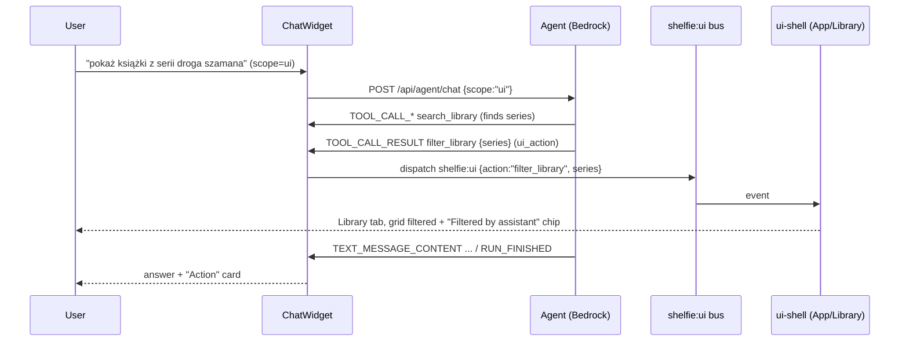

# Agent Layer — Strands Compose, AG-UI, AWS Bedrock, AWS Transcribe

Shelfie's AI layer lets the user search the library **and drive the UI by chat**, with optional
**voice input**. It runs on **AWS Bedrock** (Claude Haiku 5.5) via **Strands Compose** (declarative
YAML orchestration), exposes the work as agent tools, streams a live **AG-UI**-style event stream to
the browser over SSE, and transcribes speech with **Amazon Transcribe** streaming.

## Pieces

| Piece | Role |
|---|---|
| **AWS Bedrock** | Hosts the model the agent runs on (Haiku 5.5, region `eu-central-1`) |
| **Strands Compose** | YAML orchestration: one entry agent (`librarian`) with tools + hooks |
| **Agent tools** | Two scopes: read-only **data tools** and frontend **UI tools** (below) |
| **AG-UI** | Frontend event protocol: run lifecycle, token/thinking deltas, tool calls |
| **AWS Transcribe** | Streaming speech-to-text for voice input (pl-PL default, en-US toggle) |

## Two scopes: Library only vs Library + UI control

The chat widget header has a toggle:

- **Library only** (default) — the agent answers from the read-only data tools:
  `search_library`, `get_book_details`, `list_books`, `reading_stats`, `library_overview`.
- **Library + UI control** — the agent *additionally* gets the four **UI tools**. The scope is sent
  per request as `POST /api/agent/chat {"scope": "library" | "ui"}`. On the first `ui` turn the
  engine registers the UI tools on the entry agent and appends UI guidance to its system prompt
  (idempotent, once per session).

### UI tools (frontend-executed)

The UI tools do **not** touch the server. Each is a thin stub whose arguments mirror the UI-bus
`detail` shapes; the real effect happens in the browser (see the voice/UI bus below).

| Tool | Arguments | Effect in the browser |
|---|---|---|
| `filter_library` | `query?, series?, author?, shelf?, tag?, status?, min_stars?` | filter the Library grid |
| `clear_filter` | — | remove the assistant filter |
| `navigate` | `tab: library \| stats \| ranking` | switch the active tab |
| `open_book` | `book_id: int` | open the book detail dialog |

The agent is told to resolve real values with the data tools first (e.g. `search_library` to get the
exact series string) and only then call a UI tool.

## AG-UI event protocol (the real wire)

The backend streams a small wire protocol over SSE. Each frame keeps a **backward-compatible
`type`** (the existing frontend parser/reducer in `frontend/src/chat/` is unchanged) **and** carries
the canonical **AG-UI** name in an extra `agui` field. An AG-UI-aware client can switch on `agui`.

The mapping lives in `app/agent/agui.py`:

| wire `type` | `agui` name(s) | notes |
|---|---|---|
| `session_start` | `RUN_STARTED` | carries `session_id` |
| `reasoning` | `THINKING_TEXT_MESSAGE_CONTENT` | adaptive-thinking delta |
| `token` | `TEXT_MESSAGE_CONTENT` | answer delta |
| `tool_start` | `TOOL_CALL_START` then `tool_args` → `TOOL_CALL_ARGS` | one wire `tool_start` fans out to two AG-UI frames: name first, then args |
| `tool_end` | `TOOL_CALL_END` (data tool) / `TOOL_CALL_RESULT` (UI tool) | UI tools echo their args on this frame and set `ui_action: true` |
| `error` | `RUN_ERROR` | |
| `session_finish` | `RUN_FINISHED` (ok) / `RUN_ERROR` (not ok) | carries final `text` + `ok` |

`RUN_STARTED` / `RUN_FINISHED` map the existing `session_start` / `session_finish` lifecycle, so the
old stream contract still holds while the richer AG-UI names ride alongside.

### Verified live event sequence

Live against Bedrock (`eu-central-1`, Haiku 5.5) for the prompt
**“pokaż książki z serii droga szamana”** in `ui` scope:

```
RUN_STARTED
TOOL_CALL_START  search_library            (data)
TOOL_CALL_ARGS   search_library  {query: "Droga Szamana"}
TOOL_CALL_END    search_library            (ui_action: false)
TOOL_CALL_START  filter_library            (ui, ui_action: true)
TOOL_CALL_ARGS   filter_library  {series: "Droga Szamana"}
TOOL_CALL_RESULT filter_library  {series: "Droga Szamana"}  (ui_action: true)
TEXT_MESSAGE_CONTENT ... (answer tokens) ...
RUN_FINISHED
```

The agent first finds the series with the data tool, then calls `filter_library(series=...)` — the
acceptance criterion.

## UI bus (agent → frontend)

When a UI tool's `TOOL_CALL_RESULT` arrives (`ui_action: true`), the ChatWidget event handler calls
`dispatchUiAction()` (`frontend/src/agui/uiBus.ts`), which dispatches the wave-2 UI-bus event:

```js
window.dispatchEvent(new CustomEvent('shelfie:ui', { detail }));
```

`detail` matches the UI-bus contract
(`{ action: 'filter_library', series?, author?, ... } | { action: 'navigate', tab } |
{ action: 'open_book', book_id } | { action: 'clear_filter' }`). **ag-ui-voice dispatches; ui-shell
listens** (App switches tab, Library applies the filter and shows a removable chip). The reducer also
records a small **“Action: filtered library by series Droga Szamana”** card in the chat.



## Voice input (AWS Transcribe streaming)

A microphone button in the chat input records audio in the browser, downsamples it to **16 kHz
16-bit mono PCM**, and streams it to a backend WebSocket, which drives **Amazon Transcribe streaming**
and sends partial + final transcripts back. The **final** text is appended to the input box; the
user still presses send. Language defaults to **pl-PL** (both pl-PL and en-US are supported for
streaming); a `PL`/`EN` toggle switches it.

### WebSocket protocol — `/api/transcribe/stream`

Client → server:

1. `{"action": "start", "language": "pl-PL"}` (language optional)
2. binary frames of raw PCM (16-bit LE, 16 kHz, mono)
3. `{"action": "stop"}` (or just close)

Server → client (JSON text frames):

```
{"type": "ready",   "language": "pl-PL"}
{"type": "partial", "text": "..."}   # interim, keeps changing — drives the "Listening…" indicator
{"type": "final",   "text": "..."}   # stabilised segment — appended to the input box
{"type": "error",   "message": "..."}
```

The browser pipeline (`frontend/src/chat/useVoiceInput.ts`) handles permission-denied (a clear error
toast), a stop button, and a live recording indicator with the partial transcript. The backend
(`app/api/routes/transcribe.py` + `app/services/transcribe.py`) puts the real AWS streamer behind a
`TranscribeStreamer` seam so it can be unit-tested with a mock and injected per connection.

Credentials come from the standard AWS chain. The amazon-transcribe SDK's own resolver does not read
boto3's cached SSO credentials, so the service resolves them with **boto3** (SSO-aware) and hands the
SDK a static resolver, falling back to the SDK default chain (EC2 role / env vars) when boto3 has
none. Only `AWS_REGION` is configured in the app; no secrets live in `.env`.

```mermaid
sequenceDiagram
    participant U as User
    participant M as Mic (AudioContext → 16kHz PCM)
    participant WS as WebSocket /api/transcribe/stream
    participant T as Amazon Transcribe (streaming)
    participant I as Chat input box

    U->>M: click microphone (permission prompt)
    M->>WS: {action:"start", language:"pl-PL"}
    WS-->>M: {type:"ready", language}
    loop while recording
        M->>WS: PCM frames (100ms)
        WS->>T: audio events
        T-->>WS: partial / final results
        WS-->>M: {type:"partial"|"final", text}
        M-->>I: final text appended; partial shown as "Listening…"
    end
    U->>M: stop (or send)
    M->>WS: {action:"stop"} / close
```

## Sessions & deployment

Strands Compose resolves one session per `session_id` (isolated agent + conversation memory). The
`ChatEngine` evicts idle sessions (TTL) and reuses a session across turns. For production the layer
deploys to **Bedrock AgentCore** via `strands-compose-agentcore`; AWS credentials always come from
the standard chain (SSO / `aws configure`), never from `.env`.

## Files

- `app/agent/engine.py` — session factory, per-turn `stream(scope=...)`, AG-UI annotation.
- `app/agent/agui.py` — wire→AG-UI event-name mapping.
- `app/agent/ui_tools.py` — the four frontend UI tool stubs.
- `app/agent/tools.py` — read-only data tools.
- `app/api/routes/agent.py` — `POST /api/agent/chat` (SSE), `DELETE /api/agent/sessions/{id}`.
- `app/api/routes/transcribe.py` + `app/services/transcribe.py` — voice WebSocket + Transcribe.
- `frontend/src/agui/uiBus.ts` — dispatch a UI tool call onto `shelfie:ui`.
- `frontend/src/chat/useVoiceInput.ts` — mic capture + transcribe WebSocket client.
- `frontend/src/components/ChatWidget.tsx` — scope toggle, mic button, action cards.

## Voice input (hands-free, wave 3)

The microphone is now **hands-free and self-stopping** — it no longer records until you manually
stop. It lives in a dedicated `MicButton` component; `ChatWidget` only mounts `<MicButton … />` and
wires one callback.

### Controls

| Action | Effect |
| --- | --- |
| Click the mic (idle) | Start recording |
| Click the mic (recording) | **Stop** — the transcript drops into the input box for review |
| `Ctrl+M` | Toggle start/stop. Works while the app is focused even when the chat is closed — the panel opens first, then recording starts. |
| `Esc` (while recording) | **Cancel** — stop and discard, send nothing |
| Stop talking (after speech) | Auto-stop **and auto-send** after ~1.5 s of silence |
| Say nothing | Auto-stop (no send) after ~8 s of silence |

### End-of-speech detection — the VAD state machine

The stop/send decision is a **pure state machine** in `frontend/src/chat/voiceMachine.ts`
(`voiceMachineStep(state, input, config)`), with no browser or React dependency, so it is unit-tested
by feeding synthetic RMS frames and transcript events (`frontend/src/chat/voiceMachine.test.ts`).

Inputs are `start` / `stop` / `cancel`, audio `frame`s (each carrying the frame's **RMS level** from
a local VAD), `transcript` events (partial/final from the backend), and a periodic `tick`. Each step
returns the next state plus `effect`s (`teardown`, or `final { text, autoSend }`). Rules, all driven
by configurable constants:

- A frame with `rms >= VAD_RMS_THRESHOLD` (0.015) counts as speech and refreshes the silence timer.
- With at least one **final** transcript, `SILENCE_AFTER_SPEECH_MS` (1500 ms) of silence ends the
  utterance and emits `final { autoSend: true }` → ChatWidget sends immediately.
- With nothing ever said, `SILENCE_NO_SPEECH_MS` (8000 ms) stops recording with no `final` effect.
- A manual stop emits `final { autoSend: false }` (text goes to the input box); `cancel` emits none.

`useVoiceInput` is the impure shell: it computes `frameRms` per audio frame, feeds the machine on a
150 ms clock tick, and translates the machine's effects into side effects. It exposes
`onFinal(text, { autoSend })`, `start`, `stop`, `cancel` and `toggle`.

### Visual feedback

- A **live glow ring** around the mic button, driven by a CSS custom property `--mic-level` (0..1)
  that the hook updates from a smoothed RMS level via `requestAnimationFrame`. The ring uses theme
  colours and the recording state is red. Under `prefers-reduced-motion: reduce` the rAF loop is not
  started and the pulse animation is disabled, so the ring simply holds steady.
- The **partial transcript** is shown live just above the input while recording.
- A tooltip surfaces the `Ctrl+M` (and `Esc` to cancel) hints.

### Clean teardown (no dangling stream, mic released)

`useVoiceInput`'s `cleanup` runs on every stop/cancel/error and on unmount. It clears the tick and
rAF loops, disconnects the `ScriptProcessor` and source nodes, closes the `AudioContext`, stops every
`MediaStreamTrack` (so the browser's recording indicator turns off), sends `{"action":"stop"}` and
closes the WebSocket. On the backend, the `/api/transcribe/stream` route feeds a `None` sentinel into
the audio generator on stop/disconnect and awaits the transcription task with a 10 s timeout before
cancelling it, so the Amazon Transcribe stream is always ended — verified by
`tests/test_transcribe.py` (clean close on stop, clean close on disconnect, cancellation of a hanging
stream).

### Files (wave 3)

- `frontend/src/chat/voiceMachine.ts` (+`.test.ts`) — pure VAD + stop/send state machine.
- `frontend/src/chat/useVoiceInput.ts` (+`.test.ts`) — mic capture, VAD driving, teardown.
- `frontend/src/components/MicButton.tsx` (+`.css`) — the mic button, glow ring and shortcuts.
- `frontend/src/components/ChatWidget.tsx` — mounts `<MicButton>` and wires `onFinal`.
