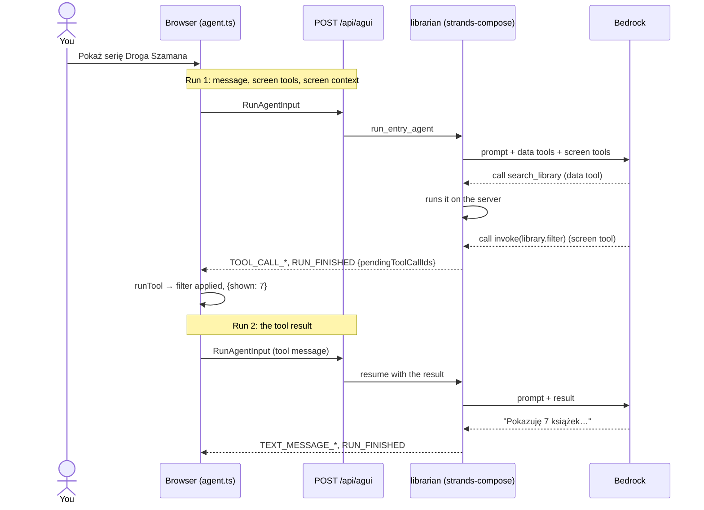

# Agent Layer — one assistant over AG-UI (strands-compose + Bedrock), AWS Transcribe

Shelfie has **one assistant**: the librarian, a strands-compose agent on AWS Bedrock
(Claude Haiku 5.5, `eu-central-1`). It speaks the **AG-UI protocol** at `POST /api/agui`.

It has two kinds of tools:

| Kind | Where it runs | Defined in | Examples |
|---|---|---|---|
| **Data tools** | server, in the agent | `app/agent/tools.py` | `search_library`, `reading_stats`, `add_book`, `update_book`, `get_series` |
| **Screen tools** | the user's browser | `frontend/src/agui/tools.ts` | `describe_ui`, `get_state`, `set`, `invoke`, `navigate` |

The browser sends its screen tools and a description of the screen with every run. The flag
`allow_client_tools: true` in `app/agent/config.yaml` lets the agent accept them. One agent
can therefore answer a data question **and** drive the screen in the same answer
("pokaż książki z serii Droga Szamana": `search_library` on the server, then
`invoke(library.filter)` in the browser).

The pattern is the same as the reference app `E:\WebDev\agui-demo` (`agent/config.yaml`,
`src/agent.ts`, `src/tools.ts`). Bedrock auth uses the long-term API key
`AWS_BEARER_TOKEN_BEDROCK`, which `app/main.py` (`_export_bedrock_token`) copies from `.env`
into the process environment for boto3; on Fly `AWS_EC2_METADATA_DISABLED=true` stops boto3
probing the EC2 metadata service.

## Who answers what

| Entry point | Request path |
|---|---|
| **Chat panel** | `ChatWidget.tsx` → `send` (`ChatProvider.tsx`) → `ask` (`frontend/src/agui/agent.ts`, `HttpAgent` from `@ag-ui/client`) → `POST /api/agui` (`app/api/routes/agui.py`) → `AgentSessions.stream` (`app/agent/sessions.py`) → librarian (`config.yaml`) |
| **Global mic** (voice) | `GlobalMic.tsx` → `/api/transcribe/stream` (WS, Amazon Transcribe) → final text → `send(text, { reveal: false })` → same chain as the chat panel. The panel stays closed; a toast shows the reply. |
| **Data question** ("ile przeczytałem w 2025?") | The librarian calls a data tool on the server (`reading_stats` …, `app/agent/tools.py` → SQLite of the logged-in user). Streams back as `TOOL_CALL_START/ARGS/END` + `TOOL_CALL_RESULT`, then the text. One run. |
| **Screen action** ("przejdź do statystyk") | The librarian calls a screen tool. The run ends with its id in `pendingToolCallIds`. The browser runs it (`runTool` → `frontend/src/agent-ui/registry.ts`), adds a `tool` message and starts the next run of the same thread. Two runs. |
| **Data change** (add / update / delete a book) | Data tools `add_book`, `update_book`, `delete_book` … The two-step confirmation for deletes and bulk updates is unchanged (prompt + `needs_confirmation`). After every answer the browser refetches the user's data (`invalidateQueries`, cheap thanks to ETag/304). |
| **Series release question** | Data tools `get_series` / `refresh_series` (`app/services/series_service.py` → researcher + editor agents, `app/agent/series_research.py`). |
| **Enrichment / insights** (not chat) | `app/services/enrichment.py`, its own Bedrock model, independent of the assistant. |

## Warm-up

When the app opens, the browser calls `POST /api/warmup` once. It loads the SDKs and builds one
throwaway agent, so the first mic click and the first run are faster. No Bedrock call. See
[features/warm-up.md](features/warm-up.md).

## One message, several runs

An AG-UI **run** is one `POST /api/agui` that streams events back.

The loop is `ask()` in `frontend/src/agui/agent.ts`:

1. Add the user message and start a run with `TOOL_DEFINITIONS` and `describeScreen()`.
2. Stream events: text and reasoning are shown as they come; every tool call is shown as a
   chip (data tool) or an action card (screen tool).
3. If the run ends with `pendingToolCallIds`, run each screen tool, add one `tool` message per
   call, wait for React to paint (a tab switch mounts new controls), and start the next run.
4. Stop when a run ends with no pending calls, or after 10 rounds.

The **server keeps the conversation** per `threadId`, so only the new input of a run is read
(the new user text or the new tool results). The `threadId` is a UUID owned by the browser; a new
`HttpAgent` is a new chat. "New chat" also calls `DELETE /api/agui/threads/{threadId}`.

## The endpoint and its sessions (`app/agent/sessions.py`)

| | |
|---|---|
| URL | `POST /api/agui` — no agent id and no session id in the URL |
| Body | AG-UI `RunAgentInput`: `threadId`, `runId`, `messages`, `tools`, `context` |
| Session | `threadId` (must be a canonical UUID; else `422`) |
| Auth | Shelfie session cookie + `X-Shelfie-Client` header, like every `/api` call |
| Response | `text/event-stream` of AG-UI events, always one `RUN_STARTED` and one terminal event |

The pieces that translate AG-UI come from `strands-compose-agentcore`:
`run_input_to_invocation` (AG-UI input → invocation), `run_entry_agent` (runs the agent with the
client tools and context), `AguiSseStream` (strands-compose events → AG-UI SSE frames).

Why not `strands_compose_agentcore.create_app` (what the demo runs): that app keeps **one session
per process**, because AgentCore Runtime gives each session its own micro-VM. Shelfie is one
process for every user, so `create_app` would let a new thread evict another user's chat and
answer `AgentBusy` to a second person. `AgentSessions` keeps one session per
**(user id, threadId)**, each with its own lock, evicted after 30 idle minutes (max 50). A user can
never load another user's thread (`tests/test_auth.py`).

The current date is prepended to the client context on every run (`_with_date`, using
`app/agent/dates.py`), so "w tym roku" is right even across midnight.

## Screen tools (`frontend/src/agui/tools.ts`)

| Tool | Effect |
|---|---|
| `describe_ui()` | The whole UI schema from the live registry (tabs → anchors with kind, label, value, options, actions; lists expose items). Already in the context; needed only after `navigate`. |
| `get_state(id)` | Read one anchor's value. |
| `set(id, value)` | Set a value control, validated against its options. |
| `invoke(id, action?, args?)` | Act on a button / dialog / list item, e.g. `invoke("library.filter", "apply", { series: "…" })`. Returns what the action returned (the library filter returns `{ filter, shown }`). |
| `navigate(tab)` | Switch the tab and wait until it is mounted. |

On failure the whole registry result (with `valid` ids or values) goes back to the agent as the
tool error, so it can correct itself. `describeScreen()` sends the same schema as AG-UI context.
Adding a control is a `useAgentAnchor` call in its component; the agent and the server do not
change. The anchor contract is in [features/ui-agent-registry.md](features/ui-agent-registry.md).

## Chat panel (`frontend/src/components/ChatWidget.tsx`)

One assistant, no mode switch. Server data tools show as small chips ("Searching your library"),
screen tools as action cards ("Go to stats"), reasoning in a collapsible block. The global mic and
the panel share one thread (`ChatProvider.tsx`), so a spoken command is visible in the chat.

## Verified live (2026-11-18, copy of the data, Bedrock Haiku 5.5)

| Command | Runs | Tools | Result |
|---|---|---|---|
| Ile książek przeczytałem w 2025 roku? | 1 | `reading_stats` (server) | "40 książek, 15 693 stron, średnia 3,69" |
| Pokaż książki z serii Droga Szamana | 3 | `invoke(library.filter)` → `shown: 0`, `search_library`, `invoke(library.filter, "The Way of the Shaman")` → `shown: 7` | grid shows the 7 books |
| Przejdź do statystyk | 2 | `navigate(stats)` once | Statistics tab |

Two bugs found and fixed while testing: the next run started before React mounted the new tab, so
the agent repeated `navigate` (fixed by waiting for the tab); and a series filter kept every book
**without** a series, because an empty name "matched" any series (`foldMatch` in
`frontend/src/settings/libraryFilter.ts`).

## Files

- `app/agent/config.yaml` — the librarian: model, prompt (data vs screen rules), `allow_client_tools: true`.
- `app/agent/tools.py` — the data tools (server).
- `app/agent/sessions.py` — `AgentSessions`: per-(user, thread) sessions, one AG-UI run → strands-compose events.
- `app/api/routes/agui.py` — `POST /api/agui`, `DELETE /api/agui/threads/{id}`.
- `app/agent/dates.py` — the current-date note.
- `frontend/src/agui/agent.ts` — the AG-UI loop (`ask`, `newAgent`, `forgetThread`).
- `frontend/src/agui/tools.ts` — the screen tools, `TOOL_DEFINITIONS`, `runTool`, `describeScreen`.
- `frontend/src/agui/labels.ts` — action-card labels.
- `frontend/src/agent-ui/` — the anchor registry.
- `frontend/src/chat/ChatProvider.tsx`, `chatState.ts` — the shared thread and the chat reducer.
- `frontend/src/components/ChatWidget.tsx`, `GlobalMic.tsx` — the UI.

Packages: `strands-compose` 0.13, `strands-agents` 1.65, `strands-compose-agentcore` 0.13
(brings `ag-ui-protocol` 1.0 and `bedrock-agentcore`); frontend `@ag-ui/client` and
`@ag-ui/core` 1.0.

Removed by this change (history is in git): `app/agent/engine.py` and `POST /api/agent/chat`
(the old library-agent wire), `app/agent/ui_agent.py` and `POST /api/agui/run` (the hand-written
Bedrock Converse runner), `app/agent/agui.py`, the browser tools `find_books`, `series_releases`,
`ask_librarian`, `librarian_add` (the agent now has the data tools itself), the scopes
`library_readonly` / `library_add`, and the hand-written SSE parsers `frontend/src/chat/sse.ts`,
`frontend/src/agui/client.ts`, `frontend/src/agui/events.ts`.

## Voice input (AWS Transcribe streaming)

A mic button records audio, downsamples to 16 kHz 16-bit mono PCM and streams it to
`/api/transcribe/stream` (WebSocket), which drives Amazon Transcribe and returns partial/final
transcripts. The final text is sent to the assistant (global mic) or dropped into the input box for
review (chat mic), pl-PL default with an en-US toggle. Transcribe credentials come from
`TRANSCRIBE_AWS_ACCESS_KEY_ID` / `TRANSCRIBE_AWS_SECRET_ACCESS_KEY` (`app/services/transcribe.py`
`_resolve_credentials`), else the boto3 chain — this path does **not** use the Bedrock bearer token.
See `frontend/src/chat/useVoiceInput.ts`, `app/api/routes/transcribe.py`, `app/services/transcribe.py`,
and [features/voice-input.md](features/voice-input.md).

### Controls

| Action | Effect |
| --- | --- |
| Click the mic (idle) | Start recording |
| Click the mic (recording) | **Stop** — the transcript drops into the input box for review |
| `Ctrl+M` | Toggle the chat mic when the panel is open, else the global mic |
| `Esc` (while recording) | **Cancel** — stop and discard, send nothing |
| Stop talking (after speech) | Auto-stop **and auto-send** after ~1.5 s of silence |
| Say nothing | Auto-stop (no send) after ~8 s of silence |

### End-of-speech detection — the VAD state machine

The stop/send decision is a **pure state machine** in `frontend/src/chat/voiceMachine.ts`
(`voiceMachineStep(state, input, config)`), with no browser or React dependency, so it is unit-tested
by feeding synthetic RMS frames and transcript events (`frontend/src/chat/voiceMachine.test.ts`).

- A frame with `rms >= VAD_RMS_THRESHOLD` (0.015) counts as speech and refreshes the silence timer.
- With at least one **final** transcript, `SILENCE_AFTER_SPEECH_MS` (1500 ms) of silence ends the
  utterance and emits `final { autoSend: true }`.
- With nothing ever said, `SILENCE_NO_SPEECH_MS` (8000 ms) stops recording with no `final` effect.
- A manual stop emits `final { autoSend: false }` (text goes to the input box); `cancel` emits none.

`useVoiceInput` is the impure shell: it computes `frameRms` per audio frame, feeds the machine on a
150 ms clock tick, and translates the machine's effects into side effects.

### Visual feedback and teardown

A live glow ring (`--mic-level`, respects `prefers-reduced-motion`), the partial transcript above the
input, and a red recording state. `cleanup` runs on every stop/cancel/error/unmount: it closes the
audio graph, stops every `MediaStreamTrack`, sends `{"action":"stop"}` and closes the WebSocket; the
backend always ends the Transcribe stream (`tests/test_transcribe.py`).

### Files

- `frontend/src/chat/voiceMachine.ts` (+`.test.ts`) — pure VAD + stop/send state machine.
- `frontend/src/chat/useVoiceInput.ts` (+`.test.ts`) — mic capture, VAD driving, teardown.
- `frontend/src/components/MicButton.tsx` (+`.css`) — the mic button and glow ring.
