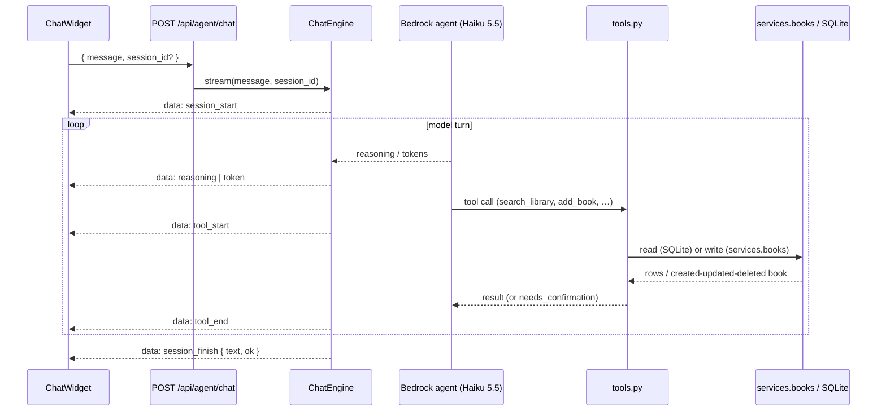

# Library assistant (chatbot)

The current chat agent: its tools, the SSE wire protocol it streams, and the chat
widget that renders it.

> Documents the current code: `app/agent/engine.py`, `app/agent/tools.py`,
> `app/agent/config.yaml`, `app/agent/dates.py`, `app/api/routes/agent.py`,
> `frontend/src/components/ChatWidget.tsx`, `frontend/src/chat/sse.ts`,
> `frontend/src/chat/chatState.ts`. The UI agent (which drives the screen and
> delegates data questions here via `ask_librarian`) and the Transcribe voice path
> are in [../agent-ag-ui-bedrock.md](../agent-ag-ui-bedrock.md).

## What it is

A single librarian agent that answers questions about the user's own library **and
manages it** — it can both read and change the library's data. It runs on **AWS
Bedrock** (Claude Haiku 5.5, `eu.anthropic.claude-haiku-5-5`, region `eu-central-1`
by default) through **strands-compose**, configured in `app/agent/config.yaml`.
Bedrock auth uses the long-term API key `AWS_BEARER_TOKEN_BEDROCK`, which `app/main.py`
(`_export_bedrock_token`) copies from `.env` into the process environment so boto3
finds it (the standard AWS chain is the fallback). The model id and region are read
from the environment, which the app copies from `.env` (`BEDROCK_MODEL_ID`,
`AWS_REGION`) before loading the config.

The agent **cannot drive the user interface** (navigate, filter the on-screen grid,
open dialogs, toggle settings/theme). That is the job of a separate UI agent in the
other chat mode; the librarian only reads and writes library *data*. (The backend
UI-control tools that used to live here — `filter_library`, `clear_filter`,
`navigate`, `open_book` and the `scope="ui"` registration hack in `engine.py` — have
been removed so there is one implementation, not two. The SSE/AG-UI event format,
including the `ui_action` flag in `app/agent/agui.py`, is unchanged and still drives
the frontend parser.)

The system prompt instructs it to answer in the user's language, always use tools
(never invent books/dates/ratings), prefer `display_score` over raw `stars` for
ranking, keep answers short, and — crucially — to run destructive or wide-reaching
writes **through a confirmation step** (see below). A `MaxToolCallsGuard` caps a turn
at **20** tool calls (`config.yaml`). Model "thinking" is **off** (`config.yaml`): the
librarian answers data questions, where the extra reasoning tokens only added latency.

## Tools

All tools live in `app/agent/tools.py`, scoped to the single user. The **read** tools
query the local SQLite DB directly (stdlib `sqlite3`, worker thread, parameterised,
max 50 rows). The **write** tools never touch SQL: they go through the same
`app.services.books` layer the HTTP API uses, so every add/update/delete obeys the
same validation, duplicate checks and schema rules. Because those services are async
and strands runs a tool synchronously, each write tool drives the service with
`asyncio.run` over a fresh `aiosqlite` connection.

### Read tools

| Tool | Purpose | Key args |
|---|---|---|
| `search_library` | Free-text search across every text field (all terms must match, case-insensitive) | `query`, `stars`, `limit` |
| `get_book_details` / `get_book` | Every stored field for one book | `book_id` |
| `list_books` | Filtered list | `status`, `shelf`, `tag`, `year`, `stars`, `sort_by` (`finished_on`/`stars`/`title`), `limit` |
| `reading_stats` | Stats for finished books in a range (reuses `app/services/stats`) | `date_from`, `date_to`, `group_by` |
| `library_overview` | Totals: per status, per shelf, top tags, rated count | — |

`search_library` / `list_books` return a compact "brief" per book (id, title,
authors, series, status, stars, display_score, finished_on, shelves, tags);
`get_book_details` returns the full `Book`.

**Star-band filter.** `search_library` and `list_books` take an optional `stars`
argument (a whole-star band `1`–`5`; `0` means any). Band N keeps books whose score
is in `(N-0.5, N+0.5]`, with the ends clamped: `5 → (4.5, 5.0]` and `1 → [0, 1.5]`
(so 5 matches 4.6–5.0, 4 matches 3.6–4.5). The score used is `display_score` when
present, else the raw `stars`; unscored books never match a band. The text query and
the star band are independent and combine with AND. This mirrors the wave-3 UI star
filter, so "only my 5-star books" from chat and the on-screen filter agree.

### Write tools (through `app.services.books`)

| Tool | Purpose | Key args | Confirmation |
|---|---|---|---|
| `add_book` | Add a book: a **Google Books** lookup (via the existing integration — pass `query`) adds the best match with full catalogue metadata; or add **manually** from fields (`title` + the rest) | `query`, `title`, `authors`, `status`, `stars`, `series`, `volume`, `published_date`, `started_on`, `finished_on`, `shelves`, `tags` | immediate |
| `update_book` | Change `status`, `stars` (0.5 steps), `started_on`, `finished_on`, `shelves`, `tags`, `notes`, `review` for one book (`book_id`) or several (`book_ids` CSV) | `book_id` / `book_ids`, the fields above, `confirm` | immediate for ≤3 books; **confirm for >3** |
| `set_insights` | Set/replace a book's structured insights (summary, characters, plot, setting, themes, tone); `source="agent"`, `generated_at` stamped | `book_id`, the six sections | immediate |
| `delete_book` | Delete one book | `book_id`, `confirm` | **always confirm** |

When a search add finds no match, `add_book` returns an error asking to add manually.
Reading fields the user supplies (status, stars, dates, shelves, tags) are applied on
top of a search match. A duplicate Google volume returns an error rather than a second
copy.

### Human-in-the-loop confirmation

`delete_book` (always) and any `update_book` touching **more than three** books are
two-phase. The first call makes **no change** and returns a result with
`needs_confirmation: true` plus a summary — for a delete, the book's title/authors;
for a bulk update, the id list, the count and the described changes. The system prompt
tells the agent to relay that summary to the user and only call the **same tool again
with `confirm=true`** once the user has agreed in chat. Single-book updates (≤3) and
`add_book` apply immediately. This keeps a destructive or wide change behind an
explicit human yes without adding any server-side session state — the gate is just the
tool's own two-call contract.

## The SSE wire protocol

`POST /api/agent/chat` takes `{ message, session_id? }` and returns a
`text/event-stream`. The engine (`ChatEngine.stream`) invokes the agent and turns
strands-compose events into a small wire protocol, one JSON object per `data:`
frame:

```
session_start -> (reasoning | token | tool_start | tool_end)* -> session_finish | error
```

| Event | Fields | Meaning |
|---|---|---|
| `session_start` | `session_id` | Turn began; carries the session id to persist |
| `reasoning` | `text` | A chunk of the model's "thinking" |
| `token` | `text` | A chunk of the answer |
| `tool_start` | `id`, `name`, `input` | A tool call began |
| `tool_end` | `id`, `name`, `status` | A tool call finished (`success`/`error`) |
| `error` | `message` | Something failed (e.g. missing AWS credentials) |
| `session_finish` | `session_id?`, `text`, `ok` | Turn ended; `text` is the final answer, `ok` false on failure |

If the agent raises (e.g. no AWS credentials at session load), the route emits an
`error` frame followed by a `session_finish` with `ok: false`, so the client always
sees a clean end.



### Sessions

The engine keeps up to 50 in-memory chat sessions, each with its own
strands-compose config and conversation memory, evicted after a 30-minute TTL (or
LRU when full). `DELETE /api/agent/sessions/{session_id}` drops one session's
state. There is **no** server-side persistence of chat history beyond the live
in-memory session.

## The chat widget

`ChatWidget.tsx` is a floating button that opens a chat panel. It:

- stores the `session_id` in `sessionStorage` (`shelfie.chat.sessionId`) and sends
  it with each message so the server reuses the session;
- parses the SSE stream with `chat/sse.ts` (`readChatStream` + `createSseParser`,
  which handles `\n\n` and `\r\n\r\n` frame boundaries, strips a leading space
  after `data:`, and ignores comments / `[DONE]`);
- reduces events into message state with `chat/chatState.ts` (a reducer that
  appends `token`/`reasoning` text, tracks per-tool chips by id, and marks the
  message `done`/`error` on finish);
- shows a collapsible **Thinking** block (auto-collapses when streaming ends),
  per-tool chips with friendly labels (e.g. `search_library` → "Searching your
  library"), and renders the final answer as markdown;
- supports **Stop** (aborts the fetch; the abort is treated as a quiet finished
  turn) and **New chat** (clears local state and calls `DELETE /api/agent/sessions/{id}`).

> The `shelfie:ui` event bus and voice input (agent → frontend navigation,
> filtering, add-book dialogs, settings, theme) are driven by the **separate UI
> agent** in the other chat mode, not by this librarian. This widget renders the
> librarian's data reads and writes; the AG-UI annotation format it shares with the
> UI agent is documented in [../agent-ag-ui-bedrock.md](../agent-ag-ui-bedrock.md).

## Verifying against Bedrock

The unit tests use a fake model/queue (no network). For a real end-to-end check,
copy the DB to a scratch location (never write the live DB), point `DB_PATH` at the
copy, and run one turn through `ChatEngine` with the compose factory. A live run of
*"dodaj książkę Diuna Franka Herberta, przeczytana w 2023, ocena 4.5"* produced the
event sequence `session_start → tool_start:add_book → tool_end:add_book(success) →
session_finish(ok)` and inserted the book via `services.books` with
`status=finished`, `stars=4.5` and `metadata_source=google_books` (the keyless
Google endpoint falls back to OpenLibrary, so the title/metadata come from whichever
source answered). The model leaves `finished_on` empty for a year-only phrase rather
than inventing a day, and asks for the exact date — consistent with the "never invent
dates" rule.


## 2026-11-08 — read-only scope, shared date injection, thinking off

### Read-only scope (`library_readonly`)

The UI agent's `ask_librarian` tool talks to the librarian through a new chat scope,
`library_readonly`, whose guarantee is enforced **server-side**: `engine._apply_scope`
removes every tool that is not read-only from the resolved agent's `tool_registry`, so the
model physically has no add/update/delete/series-edit tool to call. The allowed set
(`READONLY_TOOLS`) is search_library, get_book, get_book_details, list_books, reading_stats,
library_overview, list_series, get_series, list_favourites, list_waiting_list, series_alerts.
A read-only session also gets a prompt note (`_readonly_prompt_note`) telling it to refuse
changes. Sessions are keyed by `(user_id, scope, session_id)`, so a read-only session and a
full read+write session can share an id without aliasing each other's tools. The HTTP route
accepts `scope` in {`library`, `library_readonly`, `ui`} (legacy `ui` → `library`).

### Current date injected per reply

The librarian no longer guesses the year. `ChatEngine._apply_date_prompt` appends the shared
note from `app/agent/dates.py` (today's date, current year, "this year" = `finished_on` in
the current year, never ask the user the year) to the librarian's static system prompt **in
code, fresh every turn**. Rebuilt from the live clock each reply, so a long session stays
correct across midnight. The same module backs the UI agent's date note.

### Thinking off for speed

`additional_request_fields.thinking` was removed from `app/agent/config.yaml` (`max_tokens`
kept). Haiku 5.5 streamed adaptive reasoning before the answer; for library data questions
that only added latency.

Measured on a detached backend (temp DB copy, read-only librarian, one simple question
"ile mam książek łącznie?", warm):

| config        | time-to-first-token | total  | reasoning streamed |
|---------------|---------------------|--------|--------------------|
| thinking OFF  | ~3.5–4.0 s          | ~3.9–4.2 s | none           |
| thinking ON   | ~3.0–3.7 s warm; 11.3 s on the cold first call | ~3.1–11.5 s | none observed for this question |

For this trivial question Haiku 5.5 did not emit reasoning in either config, so warm times
overlap within noise; the clear difference is the cold first call, which spiked to 11.3 s
with thinking on and did not with it off. Removing thinking takes that tail off the table and
keeps the answer-only path lean.
