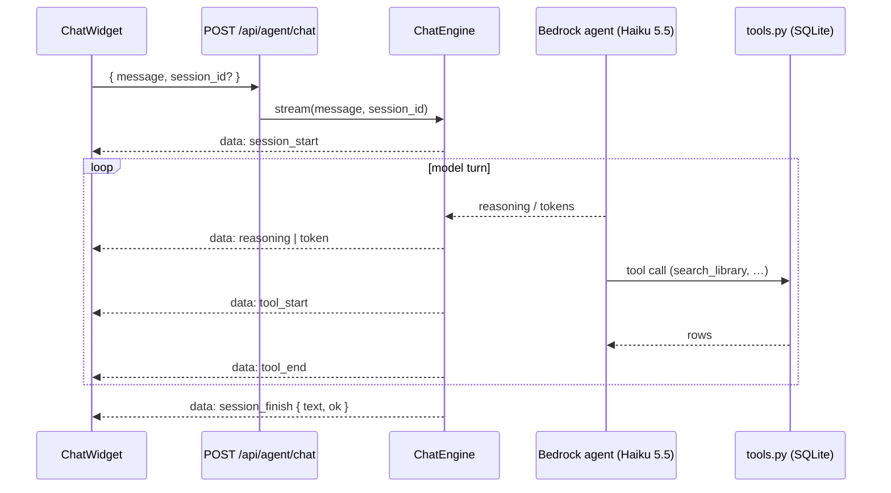

# Library assistant (chatbot)

The current chat agent: its tools, the SSE wire protocol it streams, and the chat
widget that renders it.

> Documents the current code: `app/agent/engine.py`, `app/agent/tools.py`,
> `app/agent/config.yaml`, `app/api/routes/agent.py`,
> `frontend/src/components/ChatWidget.tsx`, `frontend/src/chat/sse.ts`,
> `frontend/src/chat/chatState.ts`. The forward-looking AG-UI / voice design lives
> in [../agent-ag-ui-bedrock.md](../agent-ag-ui-bedrock.md); this file describes
> what is actually wired up today.

## What it is

A single **read-only** librarian agent that answers questions about the user's own
library. It runs on **AWS Bedrock** (Claude Haiku 5.5, `eu.anthropic.claude-haiku-5-5`,
region `eu-central-1` by default) through **strands-compose**, configured in
`app/agent/config.yaml`. Credentials come from the standard AWS chain; the model
id and region are read from the environment, which the app copies from `.env`
(`BEDROCK_MODEL_ID`, `AWS_REGION`) before loading the config.

The system prompt instructs it to answer in the user's language, always use tools
(never invent books/dates/ratings), prefer `display_score` over raw `stars` for
ranking, and keep answers short. A `MaxToolCallsGuard` caps a turn at **12** tool
calls. Haiku 5.5 streams adaptive "thinking" (reasoning) before the answer.

## Tools

All tools (`app/agent/tools.py`) are **read-only** queries over the local SQLite
DB, scoped to the single user, run synchronously in a worker thread using the
stdlib `sqlite3` driver. Every query is parameterised. Max rows per call is 50.

| Tool | Purpose | Key args |
|---|---|---|
| `search_library` | Free-text search over title, subtitle, authors, series, shelves, tags (all terms must match, case-insensitive) | `query`, `limit` |
| `get_book_details` | Every stored field for one book | `book_id` |
| `list_books` | Filtered list | `status`, `shelf`, `tag`, `year`, `sort_by` (`finished_on`/`stars`/`title`), `limit` |
| `reading_stats` | Stats for finished books in a range (reuses `app/services/stats`) | `date_from`, `date_to`, `group_by` |
| `library_overview` | Totals: per status, per shelf, top tags, rated count | — |

`search_library` / `list_books` return a compact "brief" per book (id, title,
authors, series, status, stars, display_score, finished_on, shelves, tags);
`get_book_details` returns the full `Book`.

## The SSE wire protocol

`POST /api/agent/chat` takes `{ message, session_id? }` and returns a
`text/event-stream`. The engine (`ChatEngine.stream`) invokes the agent and turns
strands-compose events into a small wire protocol, one JSON object per `data:`
frame:

```
session_start -> (reasoning | token | tool_start | tool_end)* -> session_finish | error
```

| Event | Fields | Meaning |
|---|---|---|
| `session_start` | `session_id` | Turn began; carries the session id to persist |
| `reasoning` | `text` | A chunk of the model's "thinking" |
| `token` | `text` | A chunk of the answer |
| `tool_start` | `id`, `name`, `input` | A tool call began |
| `tool_end` | `id`, `name`, `status` | A tool call finished (`success`/`error`) |
| `error` | `message` | Something failed (e.g. missing AWS credentials) |
| `session_finish` | `session_id?`, `text`, `ok` | Turn ended; `text` is the final answer, `ok` false on failure |

If the agent raises (e.g. no AWS credentials at session load), the route emits an
`error` frame followed by a `session_finish` with `ok: false`, so the client always
sees a clean end.



### Sessions

The engine keeps up to 50 in-memory chat sessions, each with its own
strands-compose config and conversation memory, evicted after a 30-minute TTL (or
LRU when full). `DELETE /api/agent/sessions/{session_id}` drops one session's
state. There is **no** server-side persistence of chat history beyond the live
in-memory session.

## The chat widget

`ChatWidget.tsx` is a floating button that opens a chat panel. It:

- stores the `session_id` in `sessionStorage` (`shelfie.chat.sessionId`) and sends
  it with each message so the server reuses the session;
- parses the SSE stream with `chat/sse.ts` (`readChatStream` + `createSseParser`,
  which handles `\n\n` and `\r\n\r\n` frame boundaries, strips a leading space
  after `data:`, and ignores comments / `[DONE]`);
- reduces events into message state with `chat/chatState.ts` (a reducer that
  appends `token`/`reasoning` text, tracks per-tool chips by id, and marks the
  message `done`/`error` on finish);
- shows a collapsible **Thinking** block (auto-collapses when streaming ends),
  per-tool chips with friendly labels (e.g. `search_library` → "Searching your
  library"), and renders the final answer as markdown;
- supports **Stop** (aborts the fetch; the abort is treated as a quiet finished
  turn) and **New chat** (clears local state and calls `DELETE /api/agent/sessions/{id}`).

> The `shelfie:ui` event bus (agent → frontend navigation/filtering) and voice
> input described in the shared contracts are **not** part of the current
> read-only widget; they belong to the AG-UI / voice workstream documented
> separately.
