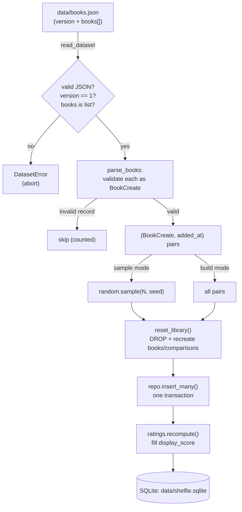
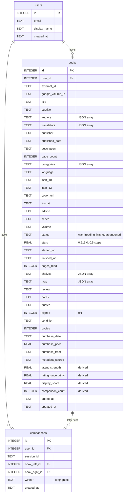

# Data pipeline: `books.json` → SQLite

How a book travels from the dataset file into the running database, what a book
record looks like, and where every field comes from.

> This documents the code as it exists today (`app/services/dataset.py`,
> `scripts/dbase.py`, `app/db.py`, `app/schemas/books.py`,
> `app/repositories/books.py`). It supersedes any earlier planning note.

## `data/books.json` is the source of truth

`data/books.json` is the single source of truth for the imported library: Google
Books metadata plus the user's own reading data. The real file holds **207 books**
(`version: 1`). `data/` is git-ignored — the dataset is personal data, not part of
the repository.

The file is a JSON object:

```json
{
  "version": 1,
  "books": [ { "title": "…", "authors": ["…"], "status": "finished", … }, … ]
}
```

- `version` **must** equal `DATASET_VERSION` (currently `1`) or the load is
  rejected with a `DatasetError` (`app/services/dataset.py`).
- `books` must be a list; each entry is validated against the `BookCreate`
  schema. Invalid records (e.g. an empty `title`) are **skipped**, not fatal.

## The two load commands

Both commands **reset the library first** (drop and recreate the `books` and
`comparisons` tables, keeping the `users` row), so running either twice never
duplicates rows.

| Command | Justfile recipe | What it does |
|---|---|---|
| `python -m scripts.dbase build` | `just build-dbase` | Load **every** valid book from the dataset |
| `python -m scripts.dbase sample [-n N]` | `just sample [N]` | Load a **random subset** of `N` books (default 40); `--seed` fixes the pick |

After loading, both recompute the rating scores for every rated book
(`app/services/ratings.recompute`) so `display_score` is populated immediately.



Key functions:

- `dataset.read_dataset(path)` — load + validate the file envelope.
- `dataset.parse_books(records)` — validate records into `(BookCreate, added_at)`
  pairs; returns the pairs and a skip count.
- `dataset.load_into_db(db_file, dataset, sample=…, seed=…)` — the whole flow;
  returns a `LoadReport(loaded, skipped, total_in_file)`.
- `scripts/dbase.py` — the CLI wrapper that also calls `ratings.recompute`.

Paths come from `Settings` (`app/config.py`): `dataset_path`
(default `data/books.json`) and `db_path` (default `data/shelfie.sqlite`), both
overridable via `.env`.

## Schema of a book

The column set lives in **one place** — `BOOK_COLUMNS` in `app/db.py` — so the
schema, the migration of older databases, and the repository all agree. The
`init_db` migration adds any column an older database is missing
(`ALTER TABLE books ADD COLUMN …`), so the schema can grow without a manual
migration step.

Every user-owned row carries a `user_id` (the single-user constant `1` for now)
so a multi-tenant switch needs no change of shape.



Indexes: `idx_books_user (user_id)`, `idx_books_volume (user_id, google_volume_id)`,
`idx_books_finished (user_id, finished_on)`.

### Every field and its origin

JSON-array columns (`authors`, `translators`, `categories`, `shelves`, `tags`)
are stored as JSON TEXT and decoded back to lists by
`repositories/books.row_to_book`. `signed` is stored as `0/1` and read back as a
bool. Dates are ISO `YYYY-MM-DD` strings.

**Origin legend:** *metadata* = fetched from Google Books / OpenLibrary · *user*
= entered or edited by the person · *derived* = computed by the rating engine ·
*system* = set automatically by the server.

| Field | Type | Origin | Notes |
|---|---|---|---|
| `id` | int | system | Auto-increment primary key |
| `external_id` | str? | metadata (import) | Original catalogue id (Goodreads-style numeric id in the dataset) |
| `google_volume_id` | str? | metadata | Google Books volume id; OpenLibrary reuses this slot for its work key. Used to dedupe on add |
| `title` | str | metadata / user | Required (1–500 chars) |
| `subtitle` | str? | metadata / user | |
| `authors` | str[] | metadata / user | |
| `translators` | str[] | user | Not provided by the search APIs |
| `publisher` | str? | metadata / user | |
| `published_date` | str? | metadata / user | Free text: `YYYY` or `YYYY-MM-DD` |
| `description` | str? | metadata / user | |
| `page_count` | int? | metadata / user | `≥ 0` |
| `categories` | str[] | metadata / user | From Google `categories` / OpenLibrary `subject` |
| `language` | str? | metadata / user | ISO-639-1 (e.g. `en`, `pl`) |
| `isbn_10` / `isbn_13` | str? | metadata / user | Extracted from `industryIdentifiers[]` |
| `cover_url` | str? | metadata / user | Google high-res HTTPS URL, an OpenLibrary cover, an uploaded `/api/covers/…`, or a pasted URL |
| `format` | str? | user | Hardcover, Paperback, eBook… |
| `edition` | str? | user | |
| `series` | str? | user | |
| `volume` | str? | user | Volume within the series |
| `status` | enum | user | `want` (default) / `reading` / `finished` / `abandoned` |
| `stars` | float? | user | `0.5..5.0` in `0.5` steps; the raw rating |
| `started_on` / `finished_on` | date? | user | |
| `pages_read` | int? | user | `≥ 0` |
| `shelves` | str[] | user | |
| `tags` | str[] | user | |
| `review` / `notes` / `quotes` | str? | user | |
| `signed` | bool | user | Default `false` |
| `condition` | str? | user | |
| `copies` | int | user | Default `1`, `≥ 0` |
| `purchase_date` | date? | user | |
| `purchase_price` | float? | user | `≥ 0` |
| `purchase_from` | str? | user | |
| `metadata_source` | str | system / import | How the catalogue data arrived — see below (default `manual`) |
| `latent_strength` | float? | derived | Rating-engine latent strength |
| `rating_uncertainty` | float? | derived | Rating-engine uncertainty |
| `display_score` | float? | derived | Refined one-decimal score shown in the UI |
| `comparison_count` | int | derived | Pairwise comparisons this book took part in |
| `added_at` | str | system / import | `datetime('now')`, or the dataset's `added_at` when importing |
| `updated_at` | str | system | `datetime('now')`, refreshed on every update |

`metadata_source` values seen in the real dataset:

| Value | Count (of 207) | Meaning |
|---|---|---|
| `google_isbn` | 183 | Matched on the import repository's ISBN against Google Books |
| `google_search` | 21 | Matched by a Google Books free-text search |
| `csv` | 3 | Carried over straight from the one-off CSV conversion (no catalogue match) |
| `manual` | — | Default for a hand-typed book (`app/schemas/books.py`) |
| `search` | — | Set by the frontend when adding a book straight from a search hit (`frontend/src/services/api.ts`) |

## The one-off CSV conversion history

`books.json` is the **only** input format the loader understands — `scripts/dbase.py`
"never reads any other format." The dataset did not start as JSON, though. It was
produced once by a one-off conversion of the user's original book export (a
Goodreads-style CSV), which is why:

- `external_id` carries the original numeric catalogue id from that export;
- `metadata_source` records how each row was reconciled afterwards — the three
  `csv` rows are the ones for which no Google Books match was found during that
  conversion, so their metadata is whatever the CSV had;
- the remaining 204 rows were enriched against Google Books by ISBN
  (`google_isbn`) or free-text search (`google_search`).

That conversion is **history**: the resulting `books.json` is now the source of
truth, and the app never re-runs the CSV import. New books enter through the UI
(search-add or manual add), not through the CSV.
