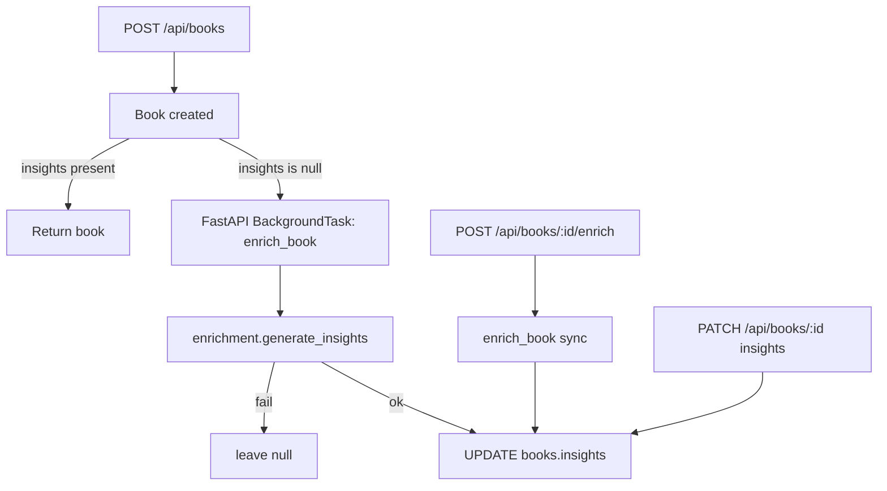

# Insights & enrichment

Every book can carry a small, structured `insights` object produced by a cheap LLM (AWS Bedrock
Claude Haiku 5.5). It is a reading aid — a one-glance account of what a book is about — and it
also makes the library assistant's full-text search far richer, because the generated prose
becomes searchable alongside the user's own notes.

Insights are **best-effort**: a model that is unsure, or a call that fails, leaves `insights`
`null`. Nothing about enrichment ever blocks a write.

## Data shape (contract 2)

`insights` is a nullable JSON object stored as a single TEXT column `insights` on the `books`
table:

```json
{
  "summary": "string | null",
  "main_characters": "string | null",
  "main_plot": "string | null",
  "setting": "string | null",
  "themes": "string | null",
  "tone": "string | null",
  "generated_at": "ISO-8601 string | null",
  "source": "agent | user | null"
}
```

- Python: `app.schemas.books.BookInsights`; `BookFields.insights` and `BookUpdate.insights` are
  `BookInsights | None`.
- TypeScript: `BookInsights` in `frontend/src/types.ts`; `Book.insights?: BookInsights | null`.
- Storage: `app/db.py` lists `insights` in `BOOK_COLUMNS` and in `JSON_OBJECT_COLUMNS`. The
  migration in `_migrate()` adds the column to databases created before this feature.
- Repository (`app/repositories/books.py`): `_to_db` serialises the object to JSON text (or
  `NULL`), `row_to_book` parses it back (or `None`).
- Dataset loader (`app/services/dataset.py`): no special handling needed — a `BookCreate`
  validates `insights` straight from the record, so `build-dbase` / `sample` carry any insights
  present in `data/books.json`.

## Generation

`app/services/enrichment.py` builds a Bedrock model the same way the chat engine does
(`app/agent/engine.py`): model id and region come from `Settings`, credentials from the AWS
chain. It then runs a plain `strands.Agent` with `structured_output_async` against a narrow
Pydantic schema (`_GeneratedInsights`, the six text fields, all nullable).

The prompt:

- is written **in the book's own language** (`language_name("pl") -> "Polish"`; Polish books get
  Polish insights), derived from the book's `language` field;
- is given only the book's title, authors, description and series/volume;
- instructs the model to answer `null` rather than invent, and to keep each field short.

Strict JSON via `structured_output_async` + Pydantic validation means a malformed answer raises
and is caught — the function returns `None`. `generated_at` (UTC) and `source="agent"` are
stamped on the validated result.

## When enrichment runs



1. **On add** (`app/api/routes/books.py` `add_book`): when the new book has no insights, a
   FastAPI `BackgroundTasks` job (`books_service.schedule_enrichment`) runs `enrich_book`, which
   opens its own DB connection (the request connection is already closed), generates insights and
   persists them. Failures are logged and leave the book unchanged.
2. **Manual rerun**: `POST /api/books/{id}/enrich` runs enrichment **synchronously** and returns
   the refreshed book (or the unchanged book on failure). Frontend client: `api.enrichBook(id)`.
3. **User edit**: insights are editable. `PATCH /api/books/{id}` accepts an `insights` object (or
   `null` to clear). The **Insights** tab in `BookFormDialog` edits the six text fields; the form
   marks hand-edited insights `source: "user"` and shows the origin/date of agent-generated ones
   (`frontend/src/bookForm.ts` `toInsights` / `insightsFromBook`).

## Dataset enrichment script

`scripts/enrich.py` (recipe `just enrich`) walks `data/books.json` book by book:

```
just enrich                       # fill missing insights in the configured data/books.json
just enrich --path copy.json      # work on another file
just enrich --limit 3             # only the first 3 that need it
just enrich --force               # redo every book
just enrich --fill-description    # also set a missing description from the summary
```

- Fills `insights` only where missing (empty/absent), unless `--force`.
- Writes the file back **atomically** (temp file + `os.replace`) **after every book**, so a crash
  or Ctrl-C keeps all progress so far.
- A book that fails to enrich keeps `insights: null` and the walk continues.
- `--fill-description` sets a missing `description` from the generated `summary`.

## Agent tools over all book data

`app/agent/tools.py`:

- `search_library` now searches **every text field** — title, subtitle, authors, translators,
  series, volume, publisher, language, format, edition, categories, shelves, tags, description,
  notes, review, quotes **and the insights** (summary, characters, plot, setting, themes, tone).
  So a query like `Arlen` finds a book whose Arlen reference lives only in its description, and a
  theme word matches a book only through its generated insights.
- `get_book` (alias of `get_book_details`) returns **every stored field** of one book, including
  the `insights` object.

Tool names are unchanged; `get_book` is added additively, so `app/agent/engine.py`'s
`config.yaml` registration (`./tools.py`, which auto-discovers all `@tool` functions) needs no
edit.

## Tests

- `tests/test_enrichment.py` — service with a fake `Agent` (no Bedrock): validated output,
  Polish-language prompt, `None` on model error / empty title; script `_needs_insights`,
  fill-only-missing + atomic write, `--limit`.
- `tests/test_insights.py` — DB round-trip through the API, user PATCH edit, clear-to-null, the
  `/enrich` endpoint (persists), 404 on missing book, full-text search finding text in a
  description (`Arlen`) and in insights, and `get_book` returning insights.
- `frontend/src/bookForm.test.ts` — insights round-trip, empty block -> `null`, user-edit marks
  `source: "user"`, agent origin/timestamp preserved when unchanged.
