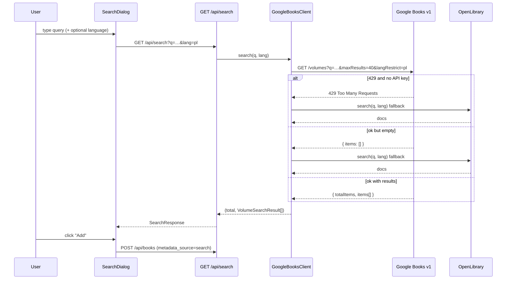

# Library view & book search

How the library grid is loaded and how adding a book by metadata search works,
including the Google Books → OpenLibrary fallback, the language filter, and the
API-key / rate-limit (429) behaviour.

> Documents the current code: `frontend/src/pages/Library.tsx`,
> `components/SearchDialog.tsx`, `hooks/useLibrary.ts`, `app/api/routes/search.py`,
> `app/services/books.py`, `app/integrations/google_books.py`,
> `app/integrations/openlibrary.py`.

## Library view

`Library.tsx` is the default page. It uses the `useLibrary` hook, which calls
`GET /api/books` once on mount and keeps the list in local state. The hook
exposes `add`, `update`, `remove` and `upsert` so dialogs can mutate the grid
without a full refetch:

- `add(volume)` → `POST /api/books` from a search hit, then prepends the result.
- `update(id, patch)` → `PATCH /api/books/{id}`.
- `remove(id)` → `DELETE /api/books/{id}`.
- `upsert(book)` → replace-or-prepend after the form dialog saves.

`GET /api/books` returns every book for the single user, ordered
`added_at DESC, id DESC` (newest first). The grid renders `BookGrid` → `BookCard`;
clicking a card opens `BookDetailDialog` (status, stars, edit, delete). Adding a
book is NOT in the Library toolbar: the round **+** button (`components/AddBookFlow.tsx`,
on every tab) opens the search dialog, and **Add manually** is inside that dialog (see
[ui-shell-and-settings.md](ui-shell-and-settings.md#add-book-button-everywhere)).

## Adding a book by search

The **Add book** dialog (`SearchDialog.tsx`) searches external catalogues and lets
the user add a hit directly, or open it prefilled in the manual form ("Edit before
adding"). A hit added directly is posted with `metadata_source: 'search'` and the
chosen starting status (default `want`).

### The search endpoint

`GET /api/search` (`app/api/routes/search.py`):

| Param | Required | Meaning |
|---|---|---|
| `q` | yes | Free text, or a qualifier: `isbn:`, `intitle:`, `inauthor:` (min length 1) |
| `lang` | no | ISO-639-1 2-letter language filter, e.g. `pl`, `en` |

It returns a `SearchResponse` of `{ total_items, items: VolumeSearchResult[] }`.
Each `VolumeSearchResult` is the normalised, not-yet-saved metadata for one book
(title, authors, publisher, ISBNs, cover, etc.).

### Google Books client & cover resolution

`GoogleBooksClient` (`app/integrations/google_books.py`) is a thin async wrapper
over `httpx`. The Google volume JSON is sparse — every `volumeInfo` field is
optional and ISBNs live in `industryIdentifiers[]` — so `normalize_volume`
null-guards everything. `max_results` is capped at 40 (the API's own limit).

Cover URLs are rewritten by `_best_cover`:
1. pick the largest available image key (`extraLarge` → … → `smallThumbnail`);
2. upgrade `http://` to `https://`;
3. strip the `edge=curl` page-curl artifact;
4. if the URL has `zoom=` but no `fife=`, append `&fife=w800` to request a larger
   render.

### Language filter

The `lang` code maps differently per source:
- **Google Books** uses `langRestrict=<iso2>` directly.
- **OpenLibrary** uses 3-letter codes, so `OpenLibraryClient` maps them:
  `en→eng, pl→pol, de→ger, fr→fre, es→spa, ru→rus` (an unknown code is passed
  through unchanged).

The dialog's language dropdown offers *Any language*, Polski, English, Deutsch,
Français, Español. When a filtered search returns nothing, the empty state
suggests trying "Any language" because the title may have no edition in that
language in the current source.

## API key, 429, and the OpenLibrary fallback

Google Books works **without** an API key, but the keyless endpoint is
aggressively rate-limited. Behaviour depends on whether `GOOGLE_BOOKS_API_KEY` is
set in `.env`:

| Situation | Behaviour |
|---|---|
| Key set | Key is sent as `?key=…`; higher quota. A 429 is **not** caught by the fallback — it surfaces. |
| No key, Google returns 429 | `GoogleBooksClient.search` falls back to **OpenLibrary** (keyless, not quota-gated), so search still works out of the box. |
| Any source returns 0 results | Falls back to OpenLibrary as a second source. |
| Google returns 429 **with** a key, or any other HTTP error | The search route maps 429 → **HTTP 429** with a hint to set `GOOGLE_BOOKS_API_KEY`; other `httpx` errors → **HTTP 502** "Google Books request failed". |

So the fallback happens at two layers:
- **Inside the client** — automatic OpenLibrary fallback on a keyless 429 or an
  empty Google result;
- **At the route** — if even the client's attempt raises, the route translates it
  to a clean 429/502 for the frontend, which shows the message in the dialog.

OpenLibrary results are normalised into the **same** `VolumeSearchResult` shape,
reusing the `google_volume_id` slot for OpenLibrary's work key so de-duplication
on add still works, and building cover URLs from
`https://covers.openlibrary.org/b/id/{cover_i}-L.jpg`.

## Duplicate protection on add

`POST /api/books` (via `services.books.add_book`) checks `google_volume_id`
against the library before inserting; a match raises `DuplicateBookError`, which
the route turns into **HTTP 409 "Book already in library"**. The search dialog
also disables the **Add** button for a hit whose `google_volume_id` is already in
the grid (shown as "In library").

## Search quota and budget messages (2026-11-07)

`GET /api/search` never returns a silent "no matches" when Google Books could not be asked.

| Google state | OpenLibrary | Response | UI |
|---|---|---|---|
| answered | - | `200`, Google results | results |
| `429` daily limit | has hits | `200` + `notice` "Google Books daily limit reached. Showing OpenLibrary results instead. Try Google again tomorrow." | yellow banner + results |
| call budget spent (`GOOGLE_BOOKS_MAX_CALLS`) | has hits | `200` + `notice` "Google Books is paused on this server…" | yellow banner + results |
| `429` or budget | nothing | `429`, detail "…OpenLibrary found nothing. Try again tomorrow, or add the book manually." | red banner + "Add manually" |

Before this, a spent budget raised `GoogleBooksBudgetExceeded` unhandled (`500`) and the
dialog showed "No matches.". Code: `app/api/routes/search.py`, tests in `tests/test_search.py`,
UI in `frontend/src/components/SearchDialog.tsx`. The dialog shows one "Add manually"
button now (the footer one hides while the empty state shows its own).
