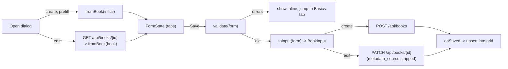
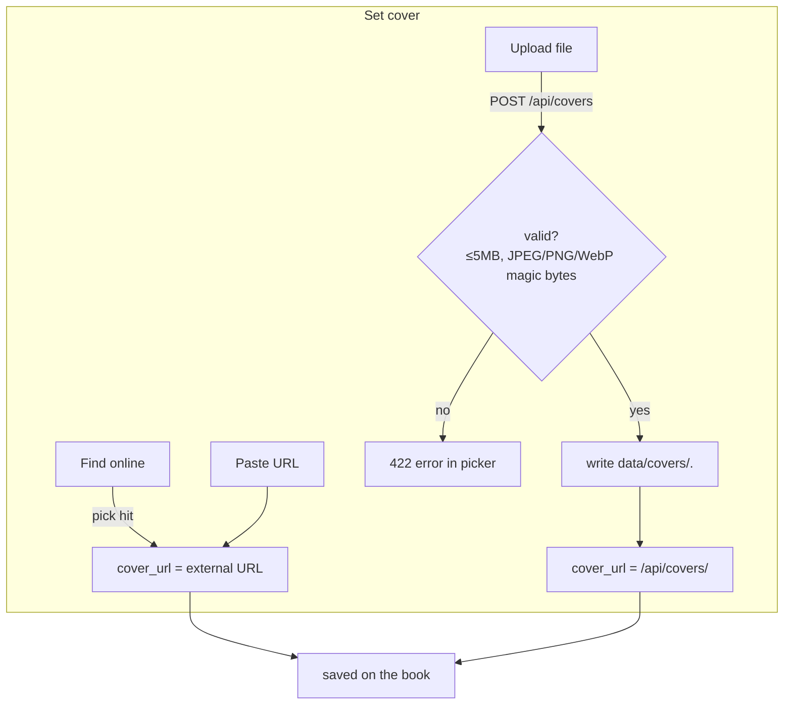

# Manual add & covers

The hand-entry book form, cover handling (search / upload / URL), where covers
are stored, and how validation is shared between the frontend and backend.

> Documents the current code: `frontend/src/components/BookFormDialog.tsx`,
> `frontend/src/bookForm.ts`, `frontend/src/components/CoverPicker.tsx`,
> `app/api/routes/covers.py`, `app/services/books.py`, `app/schemas/books.py`.

## The book form

`BookFormDialog` is used both for **create** (empty, or prefilled from a search
hit) and **edit** (loads the book via `GET /api/books/{id}`). Fields are grouped
into tabs:

| Tab | Fields |
|---|---|
| Cover | `CoverPicker` (preview + find/upload/paste) |
| Basics | title*, subtitle, authors, translators, publisher, published_date, page_count, language, isbn_13, isbn_10 |
| Series | series, volume, format, edition |
| Reading | status, stars, started_on, finished_on, pages_read |
| Organize | shelves, tags, categories |
| Notes | description, notes, review |
| Purchase | purchase_date, purchase_price, purchase_from, copies, condition, signed |

Form state (`bookForm.ts`) is deliberately "wide": every field the backend accepts
is present and non-optional so controls bind without undefined checks. Three
converters bridge the UI and API shapes:

- `emptyForm()` / `fromBook(book)` — build the editable `FormState` (lists always
  arrays, dates `Date | null`, numbers `number | null`).
- `toInput(form)` — convert back to the `BookInput` payload: trims strings,
  collapses empties to `null`, drops blank list entries, and formats dates as
  **local-time** `YYYY-MM-DD` (never UTC, to avoid off-by-one days).
- `validate(form)` — returns field→message errors.

On create the payload is posted with `metadata_source: 'manual'`. On edit the
patch deletes `metadata_source` before `PATCH` (it is not a user-editable field).
After a successful save, `onSaved(book)` upserts the result into the library grid
and syncs any open detail dialog.

## Validation (frontend mirrors backend)

`validate()` in `bookForm.ts` intentionally mirrors the Pydantic constraints in
`app/schemas/books.py` so the user sees errors before the request is sent:

| Field | Rule (both sides) |
|---|---|
| `title` | required, 1–500 chars |
| `stars` | if set, `0.5 ≤ stars ≤ 5` (0.5 steps) |
| `finished_on` | not before `started_on` (frontend check) |
| `page_count`, `pages_read`, `copies`, `purchase_price` | `≥ 0` |

The backend is the authority: `BookFields`/`BookUpdate` enforce the same bounds
and additionally normalise blank date strings to `null`
(`blank_date_to_none`) and `None` lists to `[]` (`none_to_list`). An
`ApiError` from the backend is surfaced in the dialog's error banner.

## Covers: search, upload, paste

`CoverPicker` offers three ways to set `cover_url`, plus **Remove**:

1. **Find online** — builds a query (`isbn:<isbn>` if an ISBN is present, else
   `title author`) and calls `GET /api/search`, then shows the hits that have a
   `cover_url` as a clickable grid. Picking one sets `cover_url` to that external
   URL (no copy is made — the URL points at Google/OpenLibrary).
2. **Upload** — sends the file to `POST /api/covers`; the returned
   `/api/covers/<name>` URL becomes `cover_url`. The client pre-checks ≤ 10 MB.
3. **Paste URL** — sets `cover_url` to any URL the user types.

### Cover upload endpoint & storage

`POST /api/covers` (`app/api/routes/covers.py` → `services.books.save_cover`):

- **Validation** (`save_cover`): rejects empty files, files larger than **5 MB**
  (`MAX_COVER_BYTES`), and anything whose **magic bytes** are not JPEG, PNG or
  WebP. The declared content-type is never trusted — `_sniff_image` reads the
  signature bytes. A rejection becomes **HTTP 422** with the reason.
- **Storage**: the file is written to the covers directory (`covers_dir`, default
  `data/covers`, from `Settings`) under a random name
  `<uuid4-hex>.<ext>`. The endpoint returns `{ "url": "/api/covers/<name>" }`.

> Note the two size limits: the browser pre-check allows 10 MB, but the server
> hard limit is 5 MB, so a 5–10 MB image is rejected server-side with 422.

### Serving covers safely

`GET /api/covers/{name}` only serves names this service itself generated. The name
must match `^[0-9a-f]{32}\.(jpg|png|webp)$` — no path separators, no traversal —
otherwise **404**. A valid, existing file is returned with a long immutable
`Cache-Control` (`public, max-age=31536000, immutable`), which is safe because the
name is content-unique (a new upload gets a new uuid).

