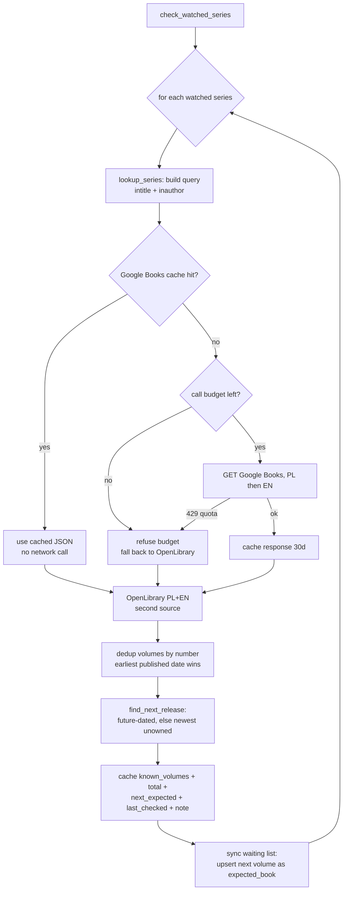

# Series tracking ("Series" tab)

Detects book *series* from the library, computes reading progress (owned / read /
unread-owned / missing volumes), lets the user **watch** a series for new releases, keeps
a **waiting list** of not-yet-owned upcoming books, and raises notifications. It is
wave 5, built on the existing book data — no new source of truth.

## Where a series comes from

A series is derived live from the user's books: every book whose `series` field is set is
grouped by a normalised **series key** (`app/services/series.py: series_key`). The key is
casefolded, accent-folded and punctuation-stripped, with a leading article dropped, so
"The Way of the Shaman", "the way of the shaman" and "Way of the Shaman" collapse to one.

Reading data (owned / read / missing) is always computed from the books. Only the *lookup
cache* and the *watch flag* are persisted, in the additive `series_info` table.

### Volume numbers

`parse_volume` extracts a number from a book's `volume` label or a title: a bare number
(`4`, `4.5`), `Tom 3`, `#6`, `Vol. 2`, `Księga II` (roman), and the Polish ordinal words
(`Etap piąty` → 5).

### Aliases (one series, several names)

A series may appear under different names across languages/editions. `series_info.aliases`
(JSON) stores the alternates; any alias resolves to the one canonical series. Example:
**King's Dark Tidings** == **Kroniki Mroku** (seeded by default in
`series_service.DEFAULT_ALIASES`). `get_series(name)` matches the query against the
canonical name *and* every alias.

## Sections

The Series tab groups series into three sections plus the waiting list:

- **In progress** — started (a volume is reading/finished) but not complete: shows
  `N of M read` and the missing-volume list with titles.
- **Watched & other** — watched series, and series owned but not started.
- **Complete** — every known volume read, nothing missing.
- **Waiting list** — not-yet-owned upcoming books (see below).

## Editing a series (wave 5)

Each series card has an **Edit** button (pencil) opening the **Series edit dialog**
(`frontend/src/components/SeriesEditDialog.tsx`). Everything the dialog does also has an
HTTP endpoint and an agent tool, so the user can type it, click it, or ask the assistant.

What can be edited:

- **Details** — display `name`, `aliases` (chips), `author`, `total volumes`, `notes`.
  Changing the name **renames the series on every member book** (`POST /{key}/rename`) and
  keeps the old name as an alias, so the series is still found by its previous name.
- **Member books** — each shows an editable **volume** field (saved on blur,
  `PATCH /{key}/books/{book_id}`) and a **remove** button (`DELETE /{key}/books/{book_id}`,
  clears the book's `series`/`volume`).
- **Add a book** — a `SearchInput` over the library (reusing `ui/SearchInput`); pick a book
  and set its volume (`POST /{key}/books`). A brand-new series name is created by adding a
  book to it.
- **Merge with…** — a series picker; the other series' books move into this one and its
  names become aliases (`POST /{key}/merge`).

Every book change is written to **both** the SQLite DB and `data/books.json`
(`app/services/books_json.py`, reusing `scripts/_dataio.py`'s identity matching: Google
volume id → ISBN-13/10 → external id → title+authors, atomic temp-file write), so the two
stores never drift. Only `series` and `volume` are ever written; reading data and the
`comparisons` table are never touched.

On phones the dialog is full-screen and single-column.

### Library agent — editing tools

`app/agent/tools.py` (the Bedrock chat assistant) gained:

- `update_series(name_or_alias, new_name?, aliases?, author?, total_volumes?, notes?)` —
  `new_name` renames across all books; `aliases` replaces the list.
- `add_book_to_series(book, series, volume?)` — "dodaj X do serii Y jako tom 3".
- `remove_book_from_series(book, series)`, `set_book_volume(book, series, volume)`.
- `merge_series(a, b)` — "połącz serie A i B".

The system prompt (`app/agent/config.yaml`) tells the assistant to use them when the user
asks to change a series.

### UI agent — anchors

`Series.tsx` registers (see [ui-agent-registry.md](ui-agent-registry.md)):

- `series.list` gained an **`edit`** action (`{ key }`) that opens the dialog.
- `series.editDialog` (a **dialog** anchor): `invoke("open", { key })` first, then `set`
  the fields (`display_name`, `author`, `aliases`, `total_volumes`, `notes`) and
  `invoke("save")`; also `add_book` / `remove_book` / `set_volume` / `rename` / `merge` /
  `cancel`.

## Release research — finding the next volume on the web (wave 5)

When the user turns **Watch for new volumes** ON, the app immediately researches the next
volume **on the open web** and stores the result so it shows on the card. The same step
backs the card's **refresh** button and `POST /api/series/check`. **It never calls Google
Books.**

### The research agent

`app/agent/series_research.py` is a small strands agent on Bedrock (Haiku, same model/env
wiring as `app/agent`), given the series, its author and the owned volume numbers. It has
exactly two web-only tools (`app/integrations/web_research.py`):

- `web_search(query)` — DuckDuckGo HTML (`https://html.duckduckgo.com/html/`, `httpx`,
  browser `User-Agent`), parsed into at most **8** `{title, url, snippet}` results.
- `fetch_url(url)` — one page's readable text, capped at **~6000 chars**.

Both are disk-cached under `data/cache/web/` with a **7-day TTL** (a cache hit makes no
network call), and share a per-run **call budget of 12** live calls (`CallBudget`), so one
research run is bounded.

The agent finds the next volume after the highest owned one **separately for the Polish
edition** (Polish publisher + `lubimyczytac`, `empik`, `taniaksiazka`, publisher site; e.g.
Wydawnictwo SQN for *Kroniki Mroku*) and the **original/English edition** (author site,
Goodreads, Amazon). It returns strict JSON `{pl:{...}, en:{...}}`, each
`{title, date, status, source_url, confidence}` where `status ∈ {announced, released,
unknown}`. **It never invents a date** — when none is found it returns `unknown` with a
null date (enforced again in `research_next_volumes`).

### Storing the result

`series_service.research_series_releases(user_id, key)`:

- stores each edition into `series_info.next_expected_pl` / `next_expected_en` (the
  combined `next_expected` is set to whichever edition has a concrete date, English first),
- upserts **one `expected_books` entry per language** (`source = series_research:pl|en`),
  leaving manual entries (`source` `agent`/`user`) untouched,
- marks the series **not complete** when a newer volume exists
  (`total_known = max(total_known, highest_owned + 1)`),
- clears the transient `checking` flag.

### Trigger & the "checking" UX

`PATCH /api/series/{key}` with `watch=true` sets `checking=true` and schedules the research
as a FastAPI **BackgroundTask**, returning at once. `POST /{key}/refresh` does the same.
The card shows a **"Checking new volumes…"** spinner while `checking` is true; the Series
tab polls `GET /api/series/{key}` (via `useSeries`) **every 3 s up to 60 s** until it
clears, then shows:

> **Next:** PL — *&lt;title · date or "not announced"&gt;* (source) · EN — *&lt;title ·
> date&gt;* (source)

Any research failure (no AWS, no network) yields an all-`unknown` result and clears
`checking`, so turning watch on never fails because research did.

```mermaid
flowchart TD
    W[PATCH watch=true] --> C[set checking=true,<br/>return 200 at once]
    C --> BG[BackgroundTask:<br/>research_series_releases]
    BG --> AG[series_research agent<br/>web_search + fetch_url<br/>budget 12, 7-day cache]
    AG --> J[JSON pl / en<br/>status announced|released|unknown<br/>never invents a date]
    J --> S[store next_expected_pl/en,<br/>upsert expected_books per lang,<br/>bump total_known, clear checking]
    C -.poll GET every 3s up to 60s.-> UI[card: spinner -> PL/EN next lines]
    S -.-> UI
```

The old Google Books + OpenLibrary checker still powers `suggest_series_fixes` (the
untagged-book dry-run below), which is a different concern; the release-research step above
is web-only and never touches Google Books.

## Legacy lookup (suggest_series_fixes only)

`suggest_series_fixes` still uses the Google Books client for per-volume title matching.
Its quota safety is unchanged:

Google Books has a hard daily quota. The client
(`app/integrations/google_books.py`) protects it (see
[backend-fastapi.md](../backend-fastapi.md#google-books-quota-safety)):

- a **persistent on-disk cache** (`data/cache/google_books/`, 30-day TTL) — the checker and
  scripts read it first; a cache hit makes no call;
- a **per-process call budget** (`GOOGLE_BOOKS_MAX_CALLS`, default 50) — refuses past it;
- **stop on the first 429** ('Queries per day') with no retries, then fall back to
  OpenLibrary and record on the cached row that the series **needs a Google re-check**.

### Check flow



### Running it

- **Manual:** `POST /api/series/check`, or a single series `POST /api/series/{key}/refresh`.
- **CLI:** `just check-series` (`scripts/check_series.py`) — one run, then exit. It never
  starts a long-running scheduler thread.
- **Scheduled (recommended):** schedule `just check-series` **daily** via Kiro Crew cron,
  e.g. a cron that runs `uv run --no-sync python -m scripts.check_series` once a day. Keep
  the watched set small so one run makes few external calls (and most are served from the
  cache).

## Notifications

`GET /api/series/alerts` returns two kinds of items:

- **series in progress** — a started series with unread owned or missing volumes;
- **new volume announced** — a watched series whose `next_expected` has a title.

The Series tab shows a **badge count** on the tab heading and a dismissible alert list.

## Waiting list

Not-yet-owned upcoming books live in the additive `expected_books` table, shown in the
Series tab's **Waiting list** section with title, author, series, expected date and a
source link, plus a remove button. Entries come from:

- the periodic checker (a watched series' next expected volume), and
- the agent tool `add_expected_book` (an announced book the user is waiting for).

The checker keeps a watched series' entry up to date (date/source/confidence).

## API

| Method | Path | Purpose |
|---|---|---|
| GET | `/api/series` | All series with computed progress |
| GET | `/api/series/{key}` | One series (key or any alias) — poll this for `checking` |
| PATCH | `/api/series/{key}` | Edit: `watch`, `display_name`, `aliases`, `author`, `total_volumes`, `notes`. `watch=true` schedules web research (returns `checking=true`) |
| POST | `/api/series/{key}/books` | `{ book_id, volume? }` add a book to the series |
| DELETE | `/api/series/{key}/books/{book_id}` | Remove a book from the series |
| PATCH | `/api/series/{key}/books/{book_id}` | `{ volume }` change a member's volume |
| POST | `/api/series/{key}/rename` | `{ name }` rename on every member book (old name → alias) |
| POST | `/api/series/{key}/merge` | `{ other_key }` merge another series into this one |
| POST | `/api/series/{key}/refresh` | Re-run web release research (returns `checking=true`) |
| POST | `/api/series/check` | Re-run web release research for every watched series |
| GET | `/api/series/alerts` | Notification items + count |
| GET | `/api/series/expected` | Waiting-list entries |
| POST | `/api/series/expected` | Add a waiting-list entry |
| DELETE | `/api/series/expected/{id}` | Remove a waiting-list entry |

## Agent tools

The Bedrock library assistant (`app/agent/tools.py`, used by the chat) gained tools so it
can answer release questions and never say it cannot check:

`list_series`, `get_series(name)` (owned/read/missing, next expected; matches aliases),
`set_series_watch(name, on)`, `refresh_series(name)` (runs the lookup now),
`list_favourites`, `set_favourite(book, on)`, `list_waiting_list`,
`add_expected_book(title, author, series?, volume?, expected_date?, source_url?)`.

## Fixing untagged books (dry-run)

Many books by a series' author have no `series`/`volume` set (e.g. most Kel Kade titles).
`series_service.suggest_series_fixes(series_key)` matches those books' titles against the
series' known volumes (from the lookup) and returns a **dry-run** list of proposed
`series`/`volume` changes — `{book_id, title, current_series, current_volume, new_series,
new_volume, matched_known_title}`. It **never modifies the data**; the list is reported for
a human to apply. Rich matching needs Google's per-volume data, so when the Google quota is
exhausted the list is produced from whatever is cached plus OpenLibrary, and the series is
flagged as needing a Google re-check.

## Data model (additive)

`app/db.py` adds two tables and a column via the idempotent startup migration (no
`build-dbase`, no table drops, `comparisons` untouched):

- `series_info (user_id, series_key, display_name, author, aliases JSON, known_volumes
  JSON, total_known, watch, next_expected JSON, next_expected_pl JSON, next_expected_en
  JSON, checking, notes, last_checked, ...)` — one row per series,
  `UNIQUE(user_id, series_key)`. `next_expected_pl/en` and `checking` are added by the
  additive migration for the release-research step.
- `expected_books (user_id, title, author, series_key, series_name, volume, expected_date,
  source_url, source, confidence, notes, ...)` — the waiting list. Research entries use
  `source = series_research:pl|en`; manual entries use `agent`/`user` and are never
  overwritten by research.
- `books.favourite` — see [favourites.md](favourites.md).

`data/books.json` is kept in sync with series/volume edits by
`app/services/books_json.py` (atomic write, identity matching via `scripts/_dataio.py`).

## Tests

- `tests/test_series_compute.py` — key normalisation, volume parsing, owned/read/missing,
  complete detection, alias folding, next-expected.
- `tests/test_series_lookup.py` — Google 429 -> OpenLibrary fallback (no hammering), status note.
- `tests/test_series_api.py` — migration on a DB copy, series listing/sections, watch toggle,
  alerts, waiting-list CRUD, alias lookup.
- `tests/test_series_edit_api.py` — metadata PATCH, add/remove/set-volume with the
  `books.json` mirror asserted, rename across members, merge, new-series creation, 404s.
- `tests/test_web_research.py` — DuckDuckGo HTML parsing, disk cache hit (no second call),
  the per-run call budget, non-http rejection, readable-text capping.
- `tests/test_series_research.py` — the research agent (mocked model) clamps an unknown
  status to a null date and yields all-unknown on failure; the service stores both
  editions, bumps `total_known`, keeps manual waiting-list entries, and `watch=true`
  returns `checking`.
- `tests/test_series_fixes.py` — the untagged-book fix dry-run (and that it never writes).
- `tests/test_google_books_cache.py` — cache hit/miss, budget, 429, TTL.

All external calls (Google Books, OpenLibrary, DuckDuckGo, page fetches, Bedrock) are
mocked in tests — no live call is made, and `conftest.py` disables enrichment and isolates
every on-disk cache so the suite never touches the network or a stale cache.

## Update 2026-11-07: UI agent answers release questions; better research

**Problem.** Asked "kiedy wyjdzie siódma część Kronik Mroku", the UI agent only had
`find_books` and answered "check the publisher yourself". The stored research for
King's Dark Tidings also had no date: the research agent searched under the English name
only and its own queries missed the author's release posts.

**UI agent tool `series_releases(name, refresh?)`** (`frontend/src/agui/tools.ts`):

| Step | What happens |
|---|---|
| match | series by name or alias, case/diacritics/inflection tolerant ("kronik mroku" → Kroniki Mroku), or by a book title in it (`matchSeries`) |
| read | owned / missing volumes and the stored next volume per edition: `next_polish`, `next_original` (title, date or "not announced", status, source) |
| `refresh=true` | `POST /api/series/{key}/refresh` (web research, never Google Books), then polls `GET /api/series/{key}` every 2 s up to 60 s |

The UI-agent system prompt (`app/agent/ui_agent.py`) tells it to call this tool for release
questions, refresh when the asked edition has no date, answer per edition and never guess.
The action card reads "Checking new volumes …".

**Research** (`app/agent/series_research.py`):
- gets the series aliases (e.g. "Kroniki Mroku"), so the Polish edition is searched under
  its Polish name;
- starts with two seeded searches: `<author> <series> book <n> release date` and
  `<Polish name> tom <n> <author> premiera`; the results go into the prompt as leads;
- prompt rules: a release-day post / past publication date = `released` with that date;
  read dates in any language; fetch the author's/publisher's page before searching again.

Live result for King's Dark Tidings after the change: EN "Ritual of Ruin", released
2025-11-11 (kelkade.com, medium); PL: no announcement found → "not announced". Both are on
the waiting list (`source = series_research:pl|en`).

Tests: `frontend/src/agui/seriesReleases.test.ts`, `frontend/src/agui/tools.test.ts`.

## Update 2026-11-08: check on app open (Fly.io)

On Fly.io the machine sleeps, so there is no daily timer. Instead `GET /api/auth/me`
(called once when the app opens) schedules `series_service.auto_check_if_stale` as a
background task:

| Rule | Value |
|---|---|
| runs when | at least one WATCHED series has `last_checked` empty or older than 24 h |
| skipped when | nothing watched, all checked < 24 h ago, a series is `checking`, or a run is already going for this person |
| what it runs | `check_watched_series` (web research PL + EN, Bedrock Haiku, never Google Books) |
| extra wake-ups | none: the app is already open |

Books added by hand to the waiting list are not re-checked; only watched series are.
Tests: `tests/test_series_autocheck.py`.


## Release research rework (wave 6 — 2026-11-08)

The watched-series release info is now one clean, facts-only summary instead of raw links
and "date unknown" waiting-list garbage.

### Search language

`series_info` gains `search_lang` (`'pl' | 'en' | 'both'`, default `'pl'`) and
`SeriesPreferences` gains `default_search_lang` (default `'pl'`). A newly-watched series
with no explicit language takes the user's default. The research searches ONLY the
requested language(s): `pl` hits Polish publishers (e.g. Fabryka Słów for Kroniki Mroku),
lubimyczytac.pl and empik.com; `en` hits the author's site, Goodreads and Amazon.

- `PATCH /api/series/{key}` accepts `"search_lang"`.
- `POST /api/series/{key}/refresh` accepts an optional body `{"search_lang": "both"}` — a
  one-off override that is also saved to the series.
- `GET/PUT /api/series/preferences` carry `default_search_lang`.

### Two-agent research → `release_summary`

`app/agent/series_research.py` now runs two agents in sequence (same Bedrock wiring,
`_build_model`): a **RESEARCHER** (existing `web_search` / `fetch_url` tools, shared
`CallBudget`) searches the requested language(s) and writes a plain-text brief, then an
**EDITOR** turns it into a strict `release_summary` JSON stored on `series_info` and
exposed on `SeriesSummary`:

```json
{
  "status": "released | announced | in_translation | no_news | unknown",
  "headline": "ONE factual Polish sentence (Google-AI-answer style)",
  "next_title": "Ritual of Ruin",         // real title, never "<series> (… tom 7)"
  "next_volume": 7,
  "expected_date": "2026",                 // free text or ISO; never invented
  "details": [{"text": "Polish bullet", "source_url": "https://…"}],
  "editions": {"pl": {"status": "…", "title": "…", "date": null, "source_url": "…"}},
  "added_book_id": 312,
  "checked_at": "ISO-8601"
}
```

`next_expected_pl` / `next_expected_en` are still filled for compatibility. A defensive
clamp rejects a mangled `next_title` that is really the series name (+ a volume tag) and
never lets an invented date survive a status with no real title.

### Waiting list & auto-add

- A waiting-list entry (source `series_research`) is created ONLY when the summary has a
  real `next_title`. Every previously-researched entry — including the old wave-5
  `series_research:pl` / `:en` garbage — is deleted on each run. Manual entries are untouched.
- When the researched edition is `released` or `announced` and no owned book has that
  volume, the step runs ONE Google Books search (`title + author`, via the existing cached,
  budgeted `GoogleBooksClient` — stops on 429/budget, no retries, no variant queries).
  A hit is accepted only when all significant title words match and the author surname is
  close (small edit distance). On success the book is added to the library with status
  `want`, `series` and `volume` set (through the book service so `books.json` stays in
  sync); `release_summary.added_book_id` is set and the matching waiting-list entry removed.
  Never adds twice. On no hit, one clean waiting-list entry is kept instead.

### Migration

`series_info` additively gains `search_lang` and `release_summary` (idempotent `_migrate`);
all existing rows keep their data and default to `search_lang='pl'`.

Tests: `tests/test_series_research.py` (lang filter, editor parsing/validation, garbage
title rejected, auto-add happy / skipped-when-owned / 429-keeps-waiting / not-twice,
migration keeps data).
