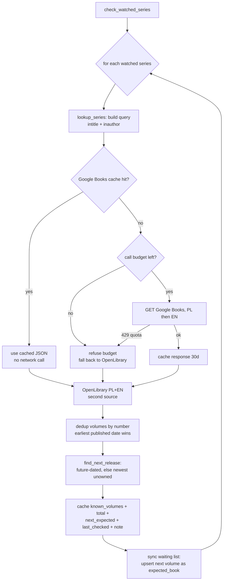

# Series tracking ("Series" tab)

Detects book *series* from the library, computes reading progress (owned / read /
unread-owned / missing volumes), lets the user **watch** a series for new releases, keeps
a **waiting list** of not-yet-owned upcoming books, and raises notifications. It is
wave 5, built on the existing book data — no new source of truth.

## Where a series comes from

A series is derived live from the user's books: every book whose `series` field is set is
grouped by a normalised **series key** (`app/services/series.py: series_key`). The key is
casefolded, accent-folded and punctuation-stripped, with a leading article dropped, so
"The Way of the Shaman", "the way of the shaman" and "Way of the Shaman" collapse to one.

Reading data (owned / read / missing) is always computed from the books. Only the *lookup
cache* and the *watch flag* are persisted, in the additive `series_info` table.

### Volume numbers

`parse_volume` extracts a number from a book's `volume` label or a title: a bare number
(`4`, `4.5`), `Tom 3`, `#6`, `Vol. 2`, `Księga II` (roman), and the Polish ordinal words
(`Etap piąty` → 5).

### Aliases (one series, several names)

A series may appear under different names across languages/editions. `series_info.aliases`
(JSON) stores the alternates; any alias resolves to the one canonical series. Example:
**King's Dark Tidings** == **Kroniki Mroku** (seeded by default in
`series_service.DEFAULT_ALIASES`). `get_series(name)` matches the query against the
canonical name *and* every alias.

## Sections

The Series tab groups series into three sections plus the waiting list:

- **In progress** — started (a volume is reading/finished) but not complete: shows
  `N of M read` and the missing-volume list with titles.
- **Watched & other** — watched series, and series owned but not started.
- **Complete** — every known volume read, nothing missing.
- **Waiting list** — not-yet-owned upcoming books (see below).

## Watch & the periodic checker

A per-series **watch** toggle ("Watch for new volumes"). Only watched series are
re-checked, so the agent never scans the whole library. `check_watched_series()`
(`app/services/series_service.py`) looks up each watched series' volumes and next release.

Sources, in order:

1. **Google Books** — `intitle:"<series>" inauthor:"<author>"`, `langRestrict` **pl then
   en** (the user reads both; e.g. the English King's Dark Tidings editions). Future /
   newest published dates give the next release.
2. **OpenLibrary** — keyless, not quota-gated; same query.
3. The library's **Bedrock agent** does deeper web research through its own tools (see
   [agent tools](#agent-tools) and [agent-ag-ui-bedrock.md](../agent-ag-ui-bedrock.md)).
   This HTTP checker itself stays Google Books + OpenLibrary only, by design.

### Google Books quota safety

Google Books has a hard daily quota. The client
(`app/integrations/google_books.py`) protects it (see
[backend-fastapi.md](../backend-fastapi.md#google-books-quota-safety)):

- a **persistent on-disk cache** (`data/cache/google_books/`, 30-day TTL) — the checker and
  scripts read it first; a cache hit makes no call;
- a **per-process call budget** (`GOOGLE_BOOKS_MAX_CALLS`, default 50) — refuses past it;
- **stop on the first 429** ('Queries per day') with no retries, then fall back to
  OpenLibrary and record on the cached row that the series **needs a Google re-check**.

### Check flow

### Running it

- **Manual:** `POST /api/series/check`, or a single series `POST /api/series/{key}/refresh`.
- **CLI:** `just check-series` (`scripts/check_series.py`) — one run, then exit. It never
  starts a long-running scheduler thread.
- **Scheduled (recommended):** schedule `just check-series` **daily** via Kiro Crew cron,
  e.g. a cron that runs `uv run --no-sync python -m scripts.check_series` once a day. Keep
  the watched set small so one run makes few external calls (and most are served from the
  cache).

## Notifications

`GET /api/series/alerts` returns two kinds of items:

- **series in progress** — a started series with unread owned or missing volumes;
- **new volume announced** — a watched series whose `next_expected` has a title.

The Series tab shows a **badge count** on the tab heading and a dismissible alert list.

## Waiting list

Not-yet-owned upcoming books live in the additive `expected_books` table, shown in the
Series tab's **Waiting list** section with title, author, series, expected date and a
source link, plus a remove button. Entries come from:

- the periodic checker (a watched series' next expected volume), and
- the agent tool `add_expected_book` (an announced book the user is waiting for).

The checker keeps a watched series' entry up to date (date/source/confidence).

## API

| Method | Path | Purpose |
|---|---|---|
| GET | `/api/series` | All series with computed progress |
| GET | `/api/series/{key}` | One series (key or any alias) |
| PATCH | `/api/series/{key}` | `{ "watch": bool }` toggle |
| POST | `/api/series/{key}/refresh` | Run the lookup for one series now |
| POST | `/api/series/check` | Re-check every watched series |
| GET | `/api/series/alerts` | Notification items + count |
| GET | `/api/series/expected` | Waiting-list entries |
| POST | `/api/series/expected` | Add a waiting-list entry |
| DELETE | `/api/series/expected/{id}` | Remove a waiting-list entry |

## Agent tools

The Bedrock library assistant (`app/agent/tools.py`, used by the chat) gained tools so it
can answer release questions and never say it cannot check:

`list_series`, `get_series(name)` (owned/read/missing, next expected; matches aliases),
`set_series_watch(name, on)`, `refresh_series(name)` (runs the lookup now),
`list_favourites`, `set_favourite(book, on)`, `list_waiting_list`,
`add_expected_book(title, author, series?, volume?, expected_date?, source_url?)`.

## Fixing untagged books (dry-run)

Many books by a series' author have no `series`/`volume` set (e.g. most Kel Kade titles).
`series_service.suggest_series_fixes(series_key)` matches those books' titles against the
series' known volumes (from the lookup) and returns a **dry-run** list of proposed
`series`/`volume` changes — `{book_id, title, current_series, current_volume, new_series,
new_volume, matched_known_title}`. It **never modifies the data**; the list is reported for
a human to apply. Rich matching needs Google's per-volume data, so when the Google quota is
exhausted the list is produced from whatever is cached plus OpenLibrary, and the series is
flagged as needing a Google re-check.

## Data model (additive)

`app/db.py` adds two tables and a column via the idempotent startup migration (no
`build-dbase`, no table drops, `comparisons` untouched):

- `series_info (user_id, series_key, display_name, author, aliases JSON, known_volumes
  JSON, total_known, watch, next_expected JSON, notes, last_checked, ...)` — one row per
  series, `UNIQUE(user_id, series_key)`.
- `expected_books (user_id, title, author, series_key, series_name, volume, expected_date,
  source_url, source, confidence, notes, ...)` — the waiting list.
- `books.favourite` — see [favourites.md](favourites.md).

## Tests

- `tests/test_series_compute.py` — key normalisation, volume parsing, owned/read/missing,
  complete detection, alias folding, next-expected.
- `tests/test_series_lookup.py` — Google 429 -> OpenLibrary fallback (no hammering), status note.
- `tests/test_series_api.py` — migration on a DB copy, series listing/sections, watch toggle,
  alerts, waiting-list CRUD, alias lookup.
- `tests/test_series_fixes.py` — the untagged-book fix dry-run (and that it never writes).
- `tests/test_google_books_cache.py` — cache hit/miss, budget, 429, TTL.

All external calls are mocked in tests — no live Google Books call is made.
