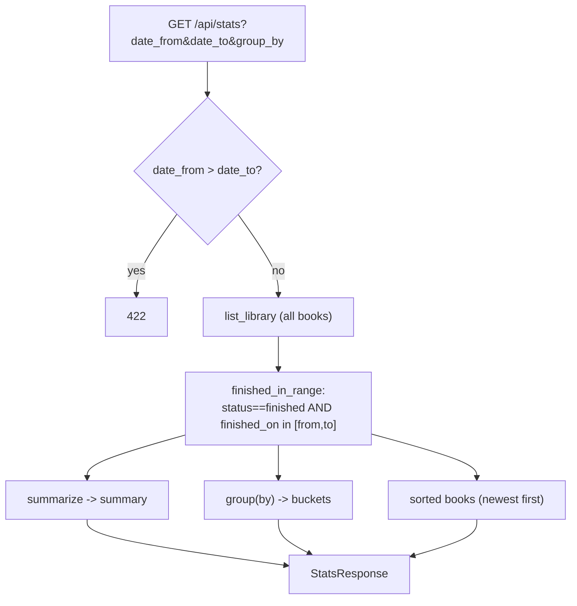

# Reading statistics

The `/api/stats` endpoint, how finished books are filtered and grouped, the date
range handling, and how the Stats page renders the summary, bar chart and table.

> Documents the current code: `app/api/routes/stats.py`, `app/services/stats.py`,
> `frontend/src/pages/Stats.tsx`, `frontend/src/statsView.ts`,
> `frontend/src/components/PlotChart.tsx`.

## The endpoint

`GET /api/stats` (`app/api/routes/stats.py`):

| Param | Type | Default | Meaning |
|---|---|---|---|
| `date_from` | date? | none | Finished **on or after** (YYYY-MM-DD) |
| `date_to` | date? | none | Finished **on or before** (YYYY-MM-DD) |
| `group_by` | enum | `month` | `shelf` / `tag` / `month` / `year` |

`date_from > date_to` is rejected with **HTTP 422**. The endpoint loads the full
library and delegates to `stats.build`, returning a `StatsResponse`:

```
StatsResponse {
  date_from, date_to, group_by,
  summary: { books, pages, average_stars, first_finished, last_finished },
  buckets: [ { key, books, pages } … ],
  books:  [ Book … ]          // the selected finished books, newest first
}
```

## What counts and how it's grouped

Only books with `status == finished` **and** a non-null `finished_on` inside the
range are selected (`finished_in_range`). Everything downstream — summary,
buckets and the returned `books` list — is computed from that selection, sorted by
`finished_on` descending.



Grouping rules (`group`):

- **`month`** → bucket key `YYYY-MM`; **`year`** → `YYYY` (from `finished_on`).
  Month/year buckets are sorted **chronologically** by key.
- **`shelf`** / **`tag`** → one bucket per shelf/tag the book carries; a book with
  no shelf/tag falls into the `—` (UNGROUPED) bucket, and a book with several is
  counted in each. Shelf/tag buckets are sorted by **count descending**, then key.

Each bucket carries both a `books` count and a `pages` total. Pages per book is
`page_count` if present, else `pages_read`, else `0` (`_pages`).

The summary (`summarize`) reports: total `books`, total `pages`, `average_stars`
(mean of the raw `stars`, 2 decimals; `null` if none rated), and the earliest /
latest `finished_on` as `first_finished` / `last_finished`.

## The Stats page

`Stats.tsx` drives the endpoint from three control groups:

- **Period** — presets (*This year*, *Last year*, *Last 12 months*, *All time*)
  via `presetRange()` in `statsView.ts`, or a custom date range (a complete
  custom range overrides the preset).
- **Group by** — month / year / shelf / tag.
- **Metric** — Books or Pages (switches which value the chart plots; this does
  **not** refetch — only range/grouping changes trigger a new request).

It renders:
1. **Summary cards** — Books read, Pages read, Average stars, Period.
2. **Bar chart** — `barOption(buckets, metric, colors)` → `PlotChart`.
3. **Table** — the selected books (cover, title, authors, finished date, stars,
   shelves) with pagination and sorting, and a **search box** above it.

### Summary cards

Each KPI card is a flex column: a small muted label on top, the big value below,
separated by `var(--small-gap)`; the card body is padded with `var(--card-padding)`.
The label and value live in a `.stats-card-inner` wrapper (PrimeReact nests card
children inside `.p-card-content`, so the gap is owned by that wrapper rather than
the card body). The Period card uses the same layout with a smaller value that wraps
cleanly (`overflow-wrap: anywhere`) so the date range never sits on the label.

### Control groups

Period / Group by / Metric each stack their label above the control with
`var(--small-gap)`, and the groups are separated with `var(--big-gap)`. The
`.stats-controls` row and each `.p-selectbutton` wrap (`flex-wrap: wrap`) so the
controls reflow onto new lines on narrow widths instead of overflowing behind the
chat panel.

### Table search

The books table has a search box (the shared `SearchInput` from
`frontend/src/ui`) with a live `N of M` count. `filterBooks(books, query)` in
`statsView.ts` filters client-side: a book matches when **every** space-separated
term appears (case-insensitively) in its title, subtitle, authors, series, shelves
or tags. An empty query returns the full list. The empty message distinguishes an
empty range ("No finished books in this range.") from a search with no hits ("No
books match your search.").

### Charts

`PlotChart` wraps `echarts-for-react`. It is theme-reactive: it reads the app's
`--app-*` CSS variables for colours and re-renders when the `data-theme` attribute
on `<html>` changes (a `MutationObserver`). Bar series get value labels, a pure-bar
chart hides the y-axis, and the default label shadow is cleared (it looks wrong in
dark mode). `statsView.ts` builds the raw ECharts option from the buckets and the
selected metric; `PlotChart` themes and enhances it before handing it to ECharts.
