# Universal UI agent — the runtime anchor registry

The in-app **UI agent** drives the interface. It used to carry one hand-written
tool per action (`set_search`, `set_star_filter`, `navigate`, `open_add_book`, …)
and a matching case in a `shelfie:ui` event bus, so **adding a tab or a control
meant editing the agent**. It is now **universal**: controls declare themselves
at runtime, and the agent discovers and drives any current or future control
through a handful of generic tools — **no agent-side code, no agent database, and
the navigation schema is built on the fly at runtime.**

## The idea in one line

Every interactive control calls `useAgentAnchor(...)` to register an **anchor**
(an addressable control) in a runtime registry. `describe_ui()` turns the live
registry into a schema; the agent reads it and acts with `get_state` / `set` /
`invoke` / `navigate`.

```mermaid
flowchart LR
    C[Component\nuseAgentAnchor&#40;...&#41;] -->|register on mount\nunregister on unmount| R[(Anchor registry\nfrontend/src/agent-ui)]
    R -->|describe_ui&#40;&#41;| SCH[UI schema\ntabs -> anchors:\nkind,label,value,options,actions,items]
    SCH -->|sent as tools + state| M[(Bedrock\nHaiku 5.5)]
    M -->|set / invoke / navigate &#40;by anchor id&#41;| R
    R -->|anchor.set / anchor.invoke| C
```

## The anchor contract (`frontend/src/agent-ui/`)

`useAgentAnchor(config)` registers one control. The config:

| Field | Meaning |
|---|---|
| `id` | Stable dotted path, unique while mounted (`library.search`, `nav.tab`, `settings.cardFields.author`, `stats.period`, `ranking.category`). |
| `kind` | `tab` / `text-input` / `search` / `select` / `toggle` / `multi-select` / `button` / `list` / `dialog`. Decides which verb applies. |
| `label`, `description?` | Human text the model reads to choose the control. |
| `tab?` | The owning tab id (so an unmounted tab's controls are still described); omitted for app-global controls (nav, theme, settings). |
| `getState?` | Read the control's current value, live. |
| `set?` | Write a value control (value kinds). |
| `invoke?(action?, args?)` | Run an action on a button / dialog / list item. |
| `options?()` | Allowed values for a `select` / `multi-select`, **derived from the data** (e.g. the years actually present). |
| `items?()` | A `list` anchor's items (bounded to 50) — e.g. the visible books. |
| `actions?` | The action names `invoke` accepts. |

The hook reads every field live from a ref, so a control passes inline closures
and changing labels without re-registering each render; it re-registers only when
the identity (`id`/`kind`) or the set of capabilities changes. Anchors register
on mount and unregister on unmount, so the registry always mirrors the mounted
UI.

## The generic agent tools (`frontend/src/agui/tools.ts`)

| Tool | Effect |
|---|---|
| `describe_ui()` | The whole UI schema from the live registry (tabs → anchors with kind, label, current value, allowed options, actions; lists expose items). **Call first.** |
| `get_state(id)` | Read one anchor's current value. |
| `set(id, value)` | Write a value control; validated against its options (error lists the valid values). |
| `invoke(id, action?, args?)` | Act on a button / dialog / list item (error lists the valid actions/ids). |
| `navigate(tab)` | Switch the active tab. |
| `find_books(query)` | Client-side: resolve a name to ids/titles. |
| `series_releases(name, refresh?)` | A series' owned/missing volumes and next volume per edition; `refresh=true` runs a live web search. |
| `ask_librarian(question)` | Ask the backend (read-only) librarian a DATA question; its answer is shown verbatim and ends the run. |

The registry tools (`describe_ui` / `get_state` / `set` / `invoke` / `navigate`) know no specific
control; `find_books`, `series_releases` and `ask_librarian` are the data/delegation tools. **Adding a tab or control is purely a
`useAgentAnchor` call** — the agent, its tools and the backend are untouched. A
dev-time guard (`frontend/src/App.test.tsx`) renders the app and asserts every
nav tab and every interactive control in a known list has an anchor, so a new
control that forgets `useAgentAnchor` fails the suite.

## Date awareness and structured filters

The backend runner injects the **current date, timezone and year** into the
system prompt every run (`app/agent/ui_agent.py`, `_date_system_block`), so a
relative period resolves without asking the user: *"this year" / "w tym roku"* =
books **finished** in the current calendar year by default, *"last year"* = the
previous year.

The library exposes **structured** filters as anchors, not just text, so a year
or period never lands in a free-text search box:

| Anchor | Facet (`frontend/src/settings/libraryFilter.ts`) |
|---|---|
| `library.finishedYear` | `finished_on` year — options = years present in the data |
| `library.startedYear` | `started_on` year |
| `library.publishedYear` | `published_date` year |
| `library.status` | reading status |
| `library.shelf` / `library.tag` / `library.series` / `library.author` | shelf / tag / series / author — options derived from the data |
| `library.filter` (`apply`/`clear`) | multi-facet apply, incl. `finished_from`/`finished_to` date range |
| `library.starFilter` | whole-star band |

The active filter shows as a **removable chip** ("Filtered by assistant · finished
2026"), so the user always sees what is applied. The model is told to pick the
structured filter for a year/period and to state the interpretation it used in one
short line.

## Which anchors ship today

- **Global:** `nav.tab`, `theme.toggle`, `settings.sidebar`, `settings.showAllDetails`,
  `settings.showVoiceButton`, and one toggle per settings card field / detail
  section (`settings.cardFields.*`, `settings.detailSections.*`).
- **Library tab:** `library.search`, `library.starFilter`, `library.filter`,
  `library.books` (list → open), `library.addBook` (search/manual; `search` with a `query` types it **and runs** the Google Books search, once per open, see `SearchDialog.test.tsx`),
  `library.dialogs` (close), and the structured facets above.
- **Stats tab:** `stats.period`, `stats.group`, `stats.metric`, `stats.tableSearch`.
- **Ranking tab:** `ranking.search`, `ranking.category`, `ranking.focus`.

## Rule for new controls

**Every new interactive control calls `useAgentAnchor`.** That one line is all
that is needed for the UI agent to discover and drive it — there is nothing to add
to the agent, its tools or any database.

## Driven from the global microphone too

The UI agent is driven not only from the chat panel but also from the **global
microphone** on the main view (see [voice-input.md](voice-input.md)). The chat and
UI-agent state is single-sourced in `frontend/src/chat/ChatProvider.tsx`, so a
transcript spoken at the global mic runs the **same** generic tools over the
**same** thread and client as the panel — it navigates, filters, searches and opens
dialogs through the registry exactly as a typed message would, without the chat
panel opening. The registry and tools are unchanged by this: they do not know or
care whether the turn came from the panel or the global mic.

A hermetic **Playwright fake-audio check** (`frontend/e2e/voice-global-mic.mjs`,
see [voice-input.md](voice-input.md#playwright-fake-audio-check-real-capture-pipeline))
proves this end to end: a spoken WAV, with the chat closed, drives a real
`navigate` through the live registry — no AWS, no Bedrock, no Google Books.

## Agent-only animations

When the **agent** acts, the user sees what it did. The user's own clicks never
animate.

- **Where it fires:** only in the browser tools `set`, `invoke` and `navigate`
  (`agui/tools.ts`), after a result with `ok: true`. They call
  `emitAgentFx({ kind, target, label })` from `agent-ui/agentFx.ts`, which
  dispatches the window event `shelfie:agent-fx`. User clicks call React
  handlers directly, so they never reach this event.
- **What plays** (`components/AgentFxLayer.tsx`, mounted once in `App.tsx`):
  - `navigate` (also `invoke nav.tab navigate`): a 0.42 s slide + fade of `.app-main`;
  - `set` / `invoke`: a 1.6 s accent glow on the changed control;
  - always: a small chip "✦ <label>" under the top bar for ~2.2 s (label from `agui/labels.describeAction`).
- **Which element glows:** `findAnchorElement(id)` looks for
  `[data-agent-anchor="<id>"]`, then for the tab's list
  (`<tab>.books` / `<tab>.list`), then falls back to `.app-main`. Current
  attributes: `library.search`, `library.starFilter`, `library.filter`,
  `library.books`, `favourites.books` (`BookGrid` `anchor` prop),
  `series.search`, `series.list`, `stats.period`, `ranking.list`.
  A new control that should glow gets `data-agent-anchor="<its anchor id>"` on
  its wrapper.
- `prefers-reduced-motion`: no motion. The glow becomes a static outline.
- Test: `frontend/src/agent-ui/agentFx.test.ts` (fires only on a successful
  agent action; fallback order of `findAnchorElement`).

## Files

- `frontend/src/agent-ui/agentFx.ts` + `components/AgentFxLayer.tsx` — agent-only animations (above).
- `frontend/src/agent-ui/types.ts` — anchor + schema types.
- `frontend/src/agent-ui/registry.ts` — the runtime registry, `describeUi`, `getAnchorState`, `setAnchor`, `invokeAnchor`, `navigate`.
- `frontend/src/agent-ui/useAgentAnchor.ts` — the React hook.
- `frontend/src/agui/tools.ts` — the generic browser tools.
- `frontend/src/agui/client.ts` — the run loop (sends the live schema as `state`).
- `app/agent/ui_agent.py` — the thin Bedrock runner; injects the date block and relays schema/tools.
- `frontend/src/App.test.tsx` — the anchor-coverage guard.

## Anchors on the Series and Favourites tabs

These tabs were added after the registry and became agent-reachable only by registering anchors; the agent code did not change:

| Anchor | Kind | Actions |
|---|---|---|
| `series.search` | search | set text |
| `series.list` | list | `watch` / `unwatch` / `refresh` / **`edit`** with `{ key }` (series key, name or alias), `open` with `{ book_id }` |
| `series.editDialog` | dialog | `open` `{ key }` (open the dialog on that series), then `set` the fields (`display_name`, `author`, `aliases`, `total_volumes`, `notes`) + `save`; also `add_book` `{ book_id, volume? }`, `remove_book` `{ book_id }`, `set_volume` `{ book_id, volume }`, `rename` `{ name }`, `merge` `{ other_key }`, `cancel` |
| `series.waitingList` | list | `remove` with `{ id }` |
| `favourites.search` | search | set text |
| `favourites.books` | list | `open` / `unfavourite` with `{ id }` |
| `library.books` | list | `open`, and now `favourite` / `unfavourite` with `{ id }` |

### The `series.editDialog` dialog anchor

A **dialog**-kind anchor (new in wave 5) lets the UI agent drive the whole Series edit
dialog without any agent-side code:

1. `invoke("open", { key })` — opens the dialog on that series (resolves key/name/alias).
2. `set({ display_name?, author?, aliases?, total_volumes?, notes? })` — stages the edited
   metadata (merged across calls).
3. `invoke("save")` — applies the staged metadata (renaming across all member books when
   `display_name` changed) and reloads.
4. Membership actions act immediately: `add_book` `{ book_id, volume? }`, `remove_book`
   `{ book_id }`, `set_volume` `{ book_id, volume }`, plus `rename` `{ name }`, `merge`
   `{ other_key }`, and `cancel`.

`getState` reports whether the dialog is open and, when open, the series' current name,
author, aliases, total, notes and member books — so the agent reads the live dialog before
acting. It is a thin wrapper over the same `/api/series/...` endpoints the human dialog
uses.

