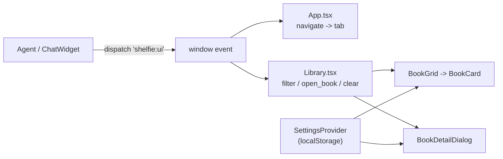

# UI shell & display settings

The React UI shell: the application bar, the library toolbar and search, the
display-settings store, the book detail view, and the agent UI bus the shell
listens on.

## App bar

`frontend/src/App.tsx` renders a single sticky app bar:

- **Brand** (left): the Shelfie logo + name.
- **Nav** (center): a segmented, underline-style tab nav (`library` /
  `stats` / `ranking`). The active tab is marked with an accent underline and
  `aria-current="page"`. It replaces the old boxed `TabMenu`.
- **Actions** (right): a theme toggle (dark/light, persisted in
  `localStorage` under `shelfie.theme`) and a settings gear button that opens
  the settings sidebar.

The bar is responsive: the nav scrolls horizontally on narrow viewports and
the toolbar rows wrap.

## Library toolbar & client-side search

`frontend/src/pages/Library.tsx` renders a toolbar row with:

- `Add book` (opens Google Books search) and `Add manually` (opens the form),
- a live book count (`N of M books` when a filter is active, else `M books`),
- a **search box** that filters the loaded library client-side by title,
  subtitle, author or series (case-insensitive substring).

Filtering is pure and unit-tested in `frontend/src/settings/libraryFilter.ts`:

- `applyFilter(books, filter)` — combines every set field with AND.
- `isEmptyFilter(filter)` — true when no constraint is active.
- `describeFilter(filter)` — one-line label for the assistant chip.

The free-text box and the assistant filter (below) compose: the assistant
filter is applied first, then the search box narrows it further.

## Display settings

Settings live in a React context backed by `localStorage`
(`frontend/src/settings/`):

- `settingsTypes.ts` — the `Settings` shape, the `CardField` / `DetailSection`
  keys, their human labels, `DEFAULT_SETTINGS` (everything ON,
  `showAllDetails` OFF), and `load`/`save`/`mergeSettings`. New fields added in
  a later version default to ON via `mergeSettings` overlaying stored values
  onto the defaults.
- `SettingsContext.tsx` — `SettingsProvider` (persists on every change) and the
  `useSettings()` hook, with `toggleCardField`, `toggleDetailSection`,
  `setShowAllDetails`, `reset`.
- `SettingsSidebar.tsx` — the PrimeReact `Sidebar` with checkboxes for card
  fields and detail sections, a "Show all details by default" switch, and a
  reset button.

Storage key: `shelfie.settings.v1`.

Settings control:

- **Library cards** (`cardFields`): author, year, status badge, score, stars,
  series, shelves, page count.
- **Book detail** (`detailSections`): reading dates, pages, score, status,
  rating, shelves, tags, series, description, insights, notes/review/quotes,
  purchase info.
- **`showAllDetails`**: the default state of the detail dialog's "Show details"
  toggle.

## Book detail view

`frontend/src/components/BookDetailDialog.tsx` shows every non-empty piece of
user data, grouped into sections, each gated by the matching
`detailSections` setting:

- Header block: cover, subtitle, authors, year, publisher, translators,
  status, rating, score, reading dates, pages, shelves, categories, and
  key/value fields for format, edition, language, copies, signed, condition,
  added date.
- Description.
- A **"Show details"** toggle (default from `showAllDetails`) that expands the
  extended sections: series, tags, **insights**, notes/review/quotes, and
  purchase info. The toggle only renders when at least one extended section has
  content.

Empty and zero-ish values are hidden: a `0`-page count, blank strings and empty
lists never render (`hasPositive` / `nonEmpty` guards).

### Insights (contract 2)

`Book.insights` is a nullable `BookInsights` object
(`summary`, `main_characters`, `main_plot`, `setting`, `themes`, `tone`,
`generated_at`, `source`). The detail dialog renders it as its own "Insights"
section when present and non-empty. The type is defined additively in
`frontend/src/types.ts`.

## Agent UI bus (contract 3)

The agent drives the frontend by dispatching a `shelfie:ui` `CustomEvent`:

```ts
window.dispatchEvent(new CustomEvent('shelfie:ui', { detail }));
```

`frontend/src/settings/uiBus.ts` defines the `UiBusEvent` union and
`parseUiBusEvent(detail)`, which validates the payload before use (untrusted
input).

| `detail.action`  | Fields                                                                 | Handled by | Effect |
|------------------|------------------------------------------------------------------------|------------|--------|
| `navigate`       | `tab: 'library' \| 'stats' \| 'ranking'`                               | App        | Switch tab |
| `filter_library` | `query? series? author? shelf? tag? status? min_stars? book_ids?`      | Library    | Apply filter + show removable chip |
| `open_book`      | `book_id: number`                                                      | Library    | Open the detail dialog |
| `clear_filter`   | —                                                                      | Library    | Remove the assistant filter |

Any filter/open/clear event also switches the app to the Library tab so the
user sees the result. The active assistant filter is shown as a removable
`Chip` labelled `Filtered by assistant · <summary>`; removing it clears the
filter.



## Tests

- `settings/libraryFilter.test.ts` — filter matching and composition (10).
- `settings/settingsTypes.test.ts` — defaults and `mergeSettings` overlay (4).
- `settings/uiBus.test.ts` — event validation (4).

Run the full gate with `just check`.
