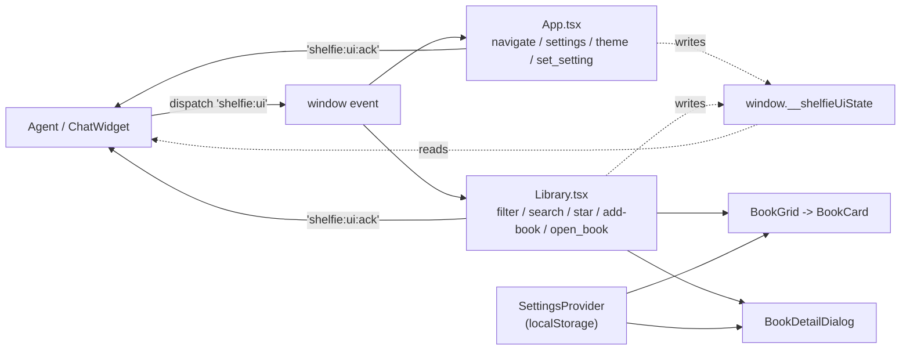

# UI shell & display settings

The React UI shell: the application bar, the library toolbar and search, the
display-settings store, the book detail view, and the agent UI bus the shell
listens on.

## App bar

`frontend/src/App.tsx` renders a single sticky app bar:

- **Brand** (left): the Shelfie logo + name.
- **Nav** (center): a segmented, underline-style tab nav (`library` /
  `stats` / `ranking`). The active tab is marked with an accent underline and
  `aria-current="page"`. It replaces the old boxed `TabMenu`.
- **Actions** (right): a theme toggle (dark/light, persisted in
  `localStorage` under `shelfie.theme`) and a settings gear button that opens
  the settings sidebar.

The bar is responsive: the nav scrolls horizontally on narrow viewports and
the toolbar rows wrap.

## Library toolbar & client-side search

`frontend/src/pages/Library.tsx` renders a toolbar row with:

- a live book count (`N of M books` when a filter is active, else `M books`),
- a **search box** that filters the loaded library client-side by title,
  subtitle, author or series (case-insensitive substring),
- a **star filter** that narrows by whole-star rating band.

Layout: `count  |  search box  |  star filter`.

## Add book button (everywhere)

Adding a book is the main action, so it is not tied to the Library tab.
`components/AddBookFlow.tsx` is mounted once in `App.tsx` and renders:

- a round accent **+** button (`.add-book-fab`) fixed ABOVE the global mic (same right edge,
  one 3.5 rem button + gap higher). With the mic off it takes the mic's spot; with the chat
  bubble off it moves to the corner. On phones it lifts above the tab bar like the mic;
- the Google Books `SearchDialog`. **Add manually** is always offered inside it (outlined
  button before a search, text link under results, a button in the empty state);
- the manual `BookFormDialog` in create mode.

The open view lives in a small store (`addBookStore`: `openSearch(query?)`,
`openManual(prefill?)`, `close()`). The agent anchor `library.addBook` is registered here
with no tab, so the assistant can open it from any tab (actions `search` / `manual` / `close`).
`library.dialogs` still reports `search` / `form` while it is open and its `close` closes it.
Tests: `components/AddBookFlow.test.tsx`.
The search box and the star filter are **independent controls**: they combine
with AND, and selecting a star band never touches the search text (and vice
versa).

### Star filter (whole stars only)

`frontend/src/components/StarFilter.tsx` offers an "Any" chip plus one chip per
whole star (1..5), each drawn as that many filled star glyphs. There are no
half-star buckets. Each bucket maps to a score band on the display scale via
`boundsForStarBucket(stars)` (consumed by `ranking.filterByScore` as
`minScore < score <= maxScore`):

| Bucket | Band          | Matches        |
|--------|---------------|----------------|
| 5      | `(4.5, 5.0]`  | 4.6 .. 5.0     |
| 4      | `(3.5, 4.5]`  | 3.6 .. 4.5     |
| 3      | `(2.5, 3.5]`  | 2.6 .. 3.5     |
| 2      | `(1.5, 2.5]`  | 1.6 .. 2.5     |
| 1      | `[0, 1.5]`    | 0 .. 1.5       |

The score is `display_score`, falling back to the user's `stars`. Selecting the
active bucket again clears the filter. The agent can drive it over the UI bus
with `set_star_filter {stars}`.

Filtering is pure and unit-tested in `frontend/src/settings/libraryFilter.ts`:

- `applyFilter(books, filter)` — combines every set field with AND.
- `isEmptyFilter(filter)` — true when no constraint is active.
- `describeFilter(filter)` — one-line label for the assistant chip.

The free-text box and the assistant filter (below) compose: the assistant
filter is applied first, then the search box narrows it further, then the star
band narrows it further still.

## Display settings

Settings live in a React context backed by `localStorage`
(`frontend/src/settings/`):

- `settingsTypes.ts` — the `Settings` shape, the `CardField` / `DetailSection`
  keys, their human labels, `DEFAULT_SETTINGS` (everything ON,
  `showAllDetails` OFF), and `load`/`save`/`mergeSettings`. New fields added in
  a later version default to ON via `mergeSettings` overlaying stored values
  onto the defaults.
- `SettingsContext.tsx` — `SettingsProvider` (persists on every change) and the
  `useSettings()` hook, with `toggleCardField`, `toggleDetailSection`,
  `setShowAllDetails`, `reset`.
- `SettingsSidebar.tsx` — the PrimeReact `Sidebar` with checkboxes for card
  fields and detail sections, a "Show all details by default" switch, and a
  reset button.

Storage key: `shelfie.settings.v1`.

Settings control:

- **Library cards** (`cardFields`): author, year, status badge, score, stars,
  series, shelves, page count.
- **Book detail** (`detailSections`): reading dates, pages, score, status,
  rating, shelves, tags, series, description, insights, notes/review/quotes,
  purchase info.
- **`showAllDetails`**: the default state of the detail dialog's "Show details"
  toggle.

## Book detail view

`frontend/src/components/BookDetailDialog.tsx` shows every non-empty piece of
user data, grouped into sections, each gated by the matching
`detailSections` setting (read via `settings.detailSections[section]`). The
setting keys the dialog reads are exactly the `DetailSection` keys in
`settingsTypes.ts`, so **every** detail-section toggle in the settings panel
visibly shows/hides that section in the dialog — the same way the library card
respects `cardFields`. This is covered by
`frontend/src/components/BookDetailDialog.test.tsx`, one case per section.

- Header block: cover, subtitle, authors, year, publisher, translators,
  status, rating, score, reading dates, pages, shelves, categories, and
  key/value fields for format, edition, language, copies, signed, condition,
  added date.
- Description.
- A **"Show details"** toggle that expands the extended sections (series, tags,
  **insights**, notes/review/quotes, purchase info). Its **default** state is
  the global `showAllDetails` setting: when `showAllDetails` is on the extended
  sections are revealed on open, when off they stay collapsed until the user
  flips the toggle. The toggle only renders when at least one extended section
  (enabled in settings) has content.

Empty and zero-ish values are hidden: a `0`-page count, blank strings and empty
lists never render (`hasPositive` / `nonEmpty` guards).

### Insights (contract 2)

`Book.insights` is a nullable `BookInsights` object
(`summary`, `main_characters`, `main_plot`, `setting`, `themes`, `tone`,
`generated_at`, `source`). The detail dialog renders it as its own "Insights"
section when present and non-empty. The type is defined additively in
`frontend/src/types.ts`.

## Agent UI bus (contract v2)

The agent drives the frontend by dispatching a `shelfie:ui` `CustomEvent`:

```ts
window.dispatchEvent(new CustomEvent('shelfie:ui', { detail }));
```

`frontend/src/settings/uiBus.ts` defines the `UiBusEvent` union and
`parseUiBusEvent(detail)`, which validates the payload before use (untrusted
input). After handling an event the shell dispatches a `shelfie:ui:ack`
`CustomEvent` (`dispatchUiAck`) carrying `{ action, ok, info? }`, so the agent
can tell whether the action took effect.

| `detail.action`   | Fields                                                            | Handled by | Effect |
|-------------------|-------------------------------------------------------------------|------------|--------|
| `navigate`        | `tab: 'library' \| 'stats' \| 'ranking'`                          | App        | Switch tab |
| `filter_library`  | `query? series? author? shelf? tag? status? min_stars? book_ids?` | Library    | Apply filter + removable chip |
| `open_book`       | `book_id: number`                                                 | Library    | Open the detail dialog (ok=false for an unknown id) |
| `clear_filter`    | —                                                                 | Library    | Remove the assistant filter |
| `set_search`      | `query: string`                                                   | Library    | Type text into the search box |
| `set_star_filter` | `stars: 1\|2\|3\|4\|5 \| null`                                    | Library    | Apply a whole-star band (null = Any) |
| `open_add_book`   | `mode: 'search'\|'manual', query?, prefill?`                      | Library    | Open the search dialog (query typed in) or the manual form (prefilled) |
| `open_settings`   | —                                                                 | App        | Open the settings sidebar |
| `close_dialogs`   | —                                                                 | App + Library | Close detail/search/form/settings |
| `set_setting`     | `key: string, value: boolean`                                     | App        | Toggle a card field / detail section / `showAllDetails` by key |
| `toggle_theme`    | —                                                                 | App        | Flip dark/light |
| `ranking`         | `query: string`                                                   | App        | Navigate to ranking (page owns its search box) |

Any filter/open/search/star event also switches the app to the Library tab so
the user sees the result. The active assistant filter is shown as a removable
`Chip` labelled `Filtered by assistant · <summary>`; removing it clears the
filter.

### State snapshot (`window.__shelfieUiState`)

App and Library keep a read-only snapshot current on `window.__shelfieUiState`
so the agent can read the live shell state:

```ts
{ tab, search, starFilter, assistantFilter, settings, visibleBookIds, openDialog }
```

`library-fixes` owns the writes (App owns `tab` + the settings dialog flag,
Library owns the rest); other workers (ui-agent) only read it.



## Tests

- `settings/libraryFilter.test.ts` — filter matching and composition (10).
- `settings/settingsTypes.test.ts` — defaults and `mergeSettings` overlay (4).
- `settings/uiBus.test.ts` — v1 + v2 event validation and ack dispatch (12).
- `components/StarFilter.test.tsx` — whole-star buckets, bounds rule, glyphs (9).
- `components/BookDetailDialog.test.tsx` — every section honours its setting,
  and `showAllDetails` drives the "Show details" default (15).
- `pages/Library.test.tsx` — bus listeners update state + ack (8).
- `App.test.tsx` — App-level bus listeners (navigate/settings/theme/set_setting) (5).

Run the full gate with `just check`.

## Update 2026-11-07: settings menu and book card layout

**Settings drawer** (`frontend/src/settings/SettingsSidebar.tsx`) is a two-level menu:

| Screen | Content |
|---|---|
| Menu | rows "Library cards" (`N of 9 fields shown`) and "Book detail" (`N of 12 sections shown`) with a chevron; switches "Show all details" and "Voice button"; "Reset to defaults" |
| Library cards / Book detail | the checkbox list for that group; the header becomes a back arrow to the menu |

The drawer always reopens on the menu.

**Book card** (`frontend/src/components/BookCard.tsx`), top to bottom:

1. title, subtitle (volume title, accent colour);
2. author · year; series line (icon + one ellipsised line); page count;
3. one row of small chips: shelves, then status (e.g. `Fantasy` `Finished`);
4. bottom row, pinned with a divider: stars left, score value right (just `4.9`, no "Score" label).

Stars and score are no longer either/or: each follows its own setting.
Phones (≤640px) get a lighter card: smaller text and chips, subtitle on one line, page count hidden.

## Update 2026-11-07: ranking compare on phones

On phones (≤640px) the compare pair stays **side by side** (left vs right) instead of
stacking, so both "I preferred this" buttons fit on one screen without scrolling.

- `frontend/src/components/ComparePair.css`: two equal columns, cover `min(150px, 22vh)`,
  smaller title (2 lines max), author on one line, small stars, no button icon, arrow-key
  hint hidden; pick buttons keep a 44px touch target.
- `frontend/src/pages/Ranking.tsx` / `Ranking.css`: "How the score works" is a collapsed
  `<details>` (tap to open); category and focus dropdowns share one row; smaller toolbar.

Checked on 390x844 and 375x667: on 390 the whole pair + "About the same" fit above the tab bar.

## Update 2026-11-08: chat button toggle

Settings menu has a **Chat button** switch (`showChatButton`, default on). Off hides the floating chat bubble; the microphone then takes the bottom-right corner (`.global-mic.no-chat`) and still drives the UI agent. The chat panel can still open from the mic toast.

