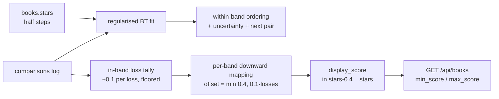

# Rating Engine — Band-Limited Dynamic Rating System

Shelfie turns a half-star rating into a **band-limited continuous score** by asking the user to
compare their books pairwise ("left or right?"). The user rates in **half stars** (0.5..5.0 in 0.5
steps). Each star value owns a narrow **band** on the display scale, and comparisons only reorder
books *inside* a band and can only push a book *downward* from its star value — so the order by user
stars is always preserved and bands never overlap.

> **Shipped behaviour (contract 1).** `display_score` is always within `[stars - 0.4, stars]`.
> A 5.0 book lives in `4.6..5.0`, a 4.5 book in `4.1..4.5`. The star filter "N stars" selects
> `display_score > N - 0.5` and `<= N`. The exact math is in
> **[Implementation (shipped)](#implementation-shipped)** below; the sections before it are the
> research that led to the design.

The core problem: recover a continuous latent strength from sparse, single-rater binary
comparisons, then map it back to a bounded per-band decimal display.

## Model options

### Elo

Expected score (logistic in rating difference):

```
E_A = 1 / (1 + 10^((R_B - R_A) / 400))
```

Update after each comparison:

```
R_A' = R_A + K * (S_A - E_A)       # S_A = 1 win, 0 loss, 0.5 tie
```

`K` controls volatility: ~40 for new entries, 24–32 default, 10–16 for settled ratings. A per-book
`K` that decays with comparison count is the practical pattern.

- **Pros:** trivial, O(1) incremental update, no batch refit.
- **Cons:** no uncertainty tracking, order-dependent (early comparisons overweighted).

### Bradley-Terry (BT)

Win probability from latent strengths:

```
P(i beats j) = s_i / (s_i + s_j)
```

With `s_i = exp(β_i)` this is the same logistic as Elo — Elo is "online BT". Fit by batch MLE
(Zermelo / MM — minorization-maximization), cheap at personal-library scale.

- **Existence caveat:** the MLE exists only if the comparison graph is *strongly connected*. Sparse
  single-user data often breaks this (a book that only ever won → infinite strength). Fix with a
  weak Bayesian prior (one virtual comparison against an average book), which also gives sane scores
  for books with 0–1 comparisons.
- **Ties:** vanilla BT has none; use the Rao–Kupper or Davidson extension (explicit "about the
  same" button), or score a tie 0.5/0.5 as in Elo.
- **Pros:** principled, order-independent global scale, uncertainty available from the Hessian.
- **Cons:** needs a batch refit (negligible cost here), fragile without a prior.

### Uncertainty-aware: TrueSkill & Glicko/Glicko-2

Track confidence, not just a point estimate.

- **TrueSkill:** skill as `N(μ, σ²)`, Bayesian updates; conservative display ≈ `μ − 3σ`. 1-vs-1
  degenerates to a clean two-player update.
- **Glicko/Glicko-2:** Elo + a Rating Deviation (RD) that grows with inactivity and shrinks with
  comparisons; Glicko-2 adds volatility.
- **What uncertainty buys:** σ/RD tells you which books are least pinned down → the best targets for
  the next comparison (active learning), honest early scores, faster convergence from few
  comparisons. **Cost:** more state and tuning; compute is negligible for a personal library.

## Design for Shelfie

**Seeding from stars.** Map the 1–5 star to a starting strength with wide initial uncertainty, e.g.
`β₀ = stars − 3` (5★ → +2). Only 5.0 books enter the pool, so they seed near the same high value
with large σ, and comparisons spread the ties apart — exactly the "refine 4.9 vs 5.0" case.

**Picking pairs (active learning).** Don't compare at random — compare for maximum information:
- **Expected Information Gain (EIG):** pick the pair whose outcome most reduces posterior
  uncertainty.
- **Near-ties:** in practice that is pairs with close predicted outcome (≈50/50) **and** high
  combined uncertainty — books with overlapping score distributions.
- **Binary-search insertion:** when a new 5.0 arrives, compare it against the book it's predicted to
  be nearest, then walk outward — O(log n) comparisons instead of comparing against everything.
- Keep the comparison graph connected (an MST over inverse-information-gain) so the BT fit stays
  well-posed.

**Latent → 1–5 display.** The latent scale is relative/interval, so apply an affine map then clamp:

```
z_i       = (β_i − mean) / spread
display_i = clamp(center + gain * z_i, 1.0, 5.0)    # rounded to 1 decimal
```

Because only 5.0 books are compared, set `center ≈ 4.8–5.0` and a small `gain` so refined scores
land in a tight band (e.g. 4.6–5.0) — "all excellent, but here's the order". Keep the raw star
rating as a floor so a 3★ book never drifts into 5.0 territory.

**Trigger sessions.** On a new 5.0 (short insertion session, 3–6 comparisons); optionally when a
book's σ/RD exceeds a threshold (stale / never well-pinned). Cap session length to avoid fatigue.

**Recalibration.** Online models (Elo/Glicko): let RD grow with time so idle books become eligible
for re-comparison. Batch BT: re-run the MM fit over all stored comparisons whenever the pool changes
materially (milliseconds at this scale), removing Elo's order-dependence.

## Recommendation

**Start with regularized Bradley-Terry (batch MM fit).**
- Tiny data volume → batch refit is effectively free, so the usual objection doesn't apply.
- Order-independent → a stable ranking of favorites, unlike incremental Elo.
- A weak prior fixes the connectivity/infinite-strength failure and gives usable scores from the
  first comparison.
- Clean log-strength → affine → 1–5 display mapping.

**Use plain Elo** for the MVP if you want the least code (a decaying K gets ~80% of the value in
~20 lines), accepting order-dependence and no uncertainty.

**Add Bayesian BT (same family, adds posterior σ)** when you want EIG-based pair selection and
staleness handling — this keeps one strength scale rather than switching paradigms to
TrueSkill/Glicko.

## Data model

```
Rating
  book_id
  stars_raw          # original 1-5 (anchor, never overwritten)
  latent_strength    # beta_i (log-strength) or Elo R_i
  uncertainty        # sigma / RD (null for plain Elo)
  volatility         # Glicko-2 only
  comparison_count   # drives K decay / staleness
  last_compared_at   # drives RD growth / recalibration
  display_score      # derived 1-5 decimal, recomputed on refit

Comparison           # ground-truth event log — kept forever
  id · session_id
  book_left_id · book_right_id
  winner             # left | right | tie
  created_at
```

**Key principle:** store the raw comparison events, not just derived scores. Every score (BT fit,
Elo replay, uncertainty, display mapping) is recomputable from the `Comparison` log, so the rating
model can change later without losing data.

## Implementation (shipped)

The shipped engine lives in `app/services/rating.py`. It is a **regularised Bradley-Terry fit**
(the recommendation above, used for ordering, pair selection and per-book uncertainty) followed by
a **band-limited, downward-only, loss-counted** mapping to the display score. Constants:
`BAND_WIDTH = 0.4`, `STEP = 0.1`, `PRIOR_WEIGHT = 2.0`.

### Bands

Every half-star value owns a band on the display scale:

```
band(stars) = [stars - BAND_WIDTH, stars]          # BAND_WIDTH = 0.4
```

Consecutive half-star values are 0.5 apart and a band is only 0.4 wide, so **bands never overlap**:
the top of a band (`stars`) always sits strictly above the top of the band below it (`stars - 0.5`).
The order by user stars is therefore always preserved; comparisons only reorder books *inside* a
band and can only move a book **down**, never up and never into a neighbour's band. The top of a
band stays pinned at its star value.

| stars | band          |
|-------|---------------|
| 5.0   | 4.6 .. 5.0    |
| 4.5   | 4.1 .. 4.5    |
| 4.0   | 3.6 .. 4.0    |
| 1.0   | 0.6 .. 1.0    |

### The fit

One global regularised Bradley-Terry model is fitted over **all** rated books by MM iteration
(`_fit_strengths`). The fit is shared across bands so cross-band comparisons still carry information
through the graph and the prior `β₀ = stars − 3`. The result is a log-strength `latentᵢ` and a
Fisher information `infoᵢ` (prior + observed games) per book. The fit drives the **within-band
ordering**, the **next-pair selection**, and the reported **uncertainty**.

### Losses → band offset (the exact formula, with the per-comparison step cap)

The display offset is driven **directly by a book's in-band loss tally**, not by its relative
position in the (globally shifting) Bradley-Terry fit. For each book, counting only comparisons
against another book with the *same* star value (a tie counts as half a loss for each side):

```
band_lossesᵢ  = number of same-band comparisons i lost  (+0.5 per tie)
offsetᵢ        = floor_to_0.1( min(BAND_WIDTH, STEP · band_lossesᵢ) )
displayᵢ       = clamp( round_to_0.1(starsᵢ − offsetᵢ),  starsᵢ − BAND_WIDTH,  starsᵢ )
```

- **No in-band losses → offset 0 → display = stars** (the band top is always pinned).
- **Each in-band loss pushes a book one 0.1 step down**, to the band floor `stars − 0.4` after
  four losses.
- **Per-comparison step cap.** Adding one comparison changes the loss tally of at most the two
  books involved, each by at most one full loss (or half a loss for a tie). Because the offset is
  `0.1 · losses` *floored* to 0.1, a single comparison can move a display score by **at most one
  0.1 step**, never moves a book that was not in the comparison, and needs **four in-band losses to
  reach the floor** — the refinement is gradual by construction.

> **Why this replaced the earlier mapping.** The previous engine normalised each book's
> Bradley-Terry strength against the strongest and weakest member of its band
> (`raw_offset = BAND_WIDTH · (latent_max − latentᵢ) / spread`, shrunk by a confidence factor).
> That mapping was *relative*, so adding a single comparison could shift the whole band's
> normalisation and move a book — **even an uninvolved one — by up to 0.5 in one step**. That is
> the bug users saw ("a book dropped by 0.5 after one comparison"). The loss-counted mapping is
> local and additive, so the 0.1 step cap holds by construction.

### Worked example

Band 5.0 holds three books A, B, C. A has never lost in-band, B has lost two in-band comparisons,
C has lost five:

```
offset_A = floor_to_0.1(min(0.4, 0.1 · 0)) = 0.0  → display 5.0
offset_B = floor_to_0.1(min(0.4, 0.1 · 2)) = 0.2  → display 4.8
offset_C = floor_to_0.1(min(0.4, 0.1 · 5)) = 0.4  → display 4.6   (capped at the floor)
```

If C had lost only once so far, `offset_C = 0.1 → display 4.9`; it sinks exactly one 0.1 step per
loss, so it needs four in-band losses to reach the 4.6 floor.

### Pair selection

Pairs are **always drawn from one category**: a book's group is its *primary (first) shelf*,
falling back to its *first category*, or `None` when it has neither. `next_pair(..., groups=…)`
never pairs two books from different groups, and a book with no category (`None`) is only paired
with other uncategorised books — never across categories. The Ranking page exposes a category
selector (defaulting to the category with the most rated books) and passes the chosen group to
`GET /api/ratings/pair?group=…`; `ratings.suggest_pair` restricts the eligible books to that group.

Within the chosen group, `next_pair` ranks candidate pairs in tiers, highest first:

1. **same band** (same star value) — where comparisons actually refine the order;
2. **adjacent-band boundary** — the bottom of a band versus the top of the band just below it
   (e.g. a 4.6-end 5.0 book versus a 4.5-starred book), confirming the bands sit correctly;
3. everything else.

Within a tier it prefers the pair with the closest predicted outcome (≈50/50) and the largest
combined uncertainty (the least-pinned-down books), skipping already-asked pairs. A `focus` book
id restricts suggestions to pairs containing that book (the Ranking page's per-row **Focus**
button and the focus dropdown set it).

### Star filter

The list endpoint `GET /api/books` takes optional `min_score` / `max_score` floats and applies
`display_score > min_score AND display_score <= max_score`. The frontend maps a star bucket N to
`min_score = N − 0.5`, `max_score = N` (`frontend/src/ranking.ts::scoreBoundsForStars`), so "5
stars" shows `4.6..5.0`, "4.5 stars" shows `4.1..4.5`, per contract 1.

### Data flow



### Ranking page (frontend)

`frontend/src/pages/Ranking.tsx` drives three refinements on top of the engine:

- **Category selector.** `ranking.ts::groupOptions` lists each category (primary shelf, else first
  category, else "Uncategorised") with its rated-book count; `defaultGroup` picks the busiest one
  as the default. The selected group is passed to `GET /api/ratings/pair?group=…` so every
  suggested pair stays within one category.
- **Search box.** `ranking.ts::filterBySearch` filters the ranking table by title, author(s) and
  series (case-insensitive). A per-row **Focus** button, and a focus dropdown, pin the next
  comparisons to one book via `?focus=…`.
- **UI bus listener.** The page listens for the `shelfie:ui` event
  `ranking { action: 'search', query }`, puts the query into the search box, and answers with a
  `shelfie:ui:ack` event `{ action: 'ranking', ok, info }` so the agent knows it was handled
  (UI bus contract v2).

## Sources

- Elo formula, K-factor, Elo↔BT: metricgate.com/docs/elo-rating, calculatorlib.com
- Bradley-Terry MLE / MM, existence, ties: arxiv.org/html/2207.00076v1, arxiv.org/html/1411.1168v1,
  arxiv.org/html/2110.11487v2
- Active sampling / EIG / MST pair selection: arxiv.org/html/1810.08851v1, arxiv.org/pdf/2004.05691
- TrueSkill, Glicko/Glicko-2: arxiv.org/html/2303.14857v1, arxiv.org/html/2104.14012
